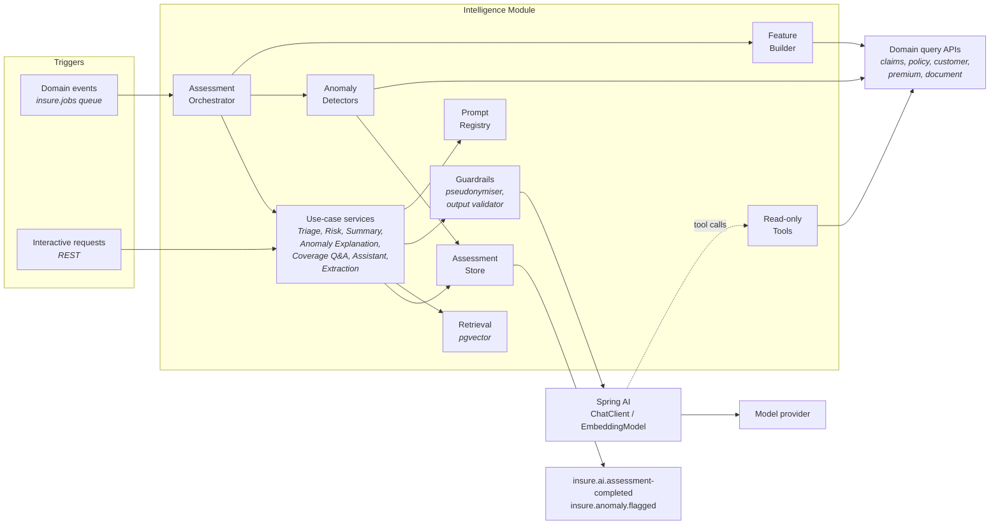
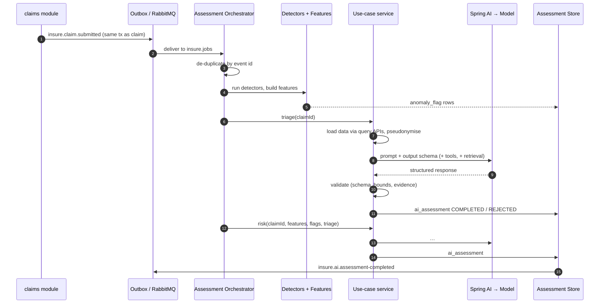

# Intelligence Architecture

How the intelligence layer is structured, how it runs, and how it is kept separate from the deterministic insurance domain.

## Principles

1. **Advisory only.** The intelligence layer produces recommendations, scores, flags, extractions, summaries, and answers. It never changes a policy, claim, or payment. Decision rights are defined in [AI Decisioning](ai-decisioning.md).
2. **The domain works without it.** Domain modules do not depend on the intelligence module ([Component Diagram](../architecture/component-diagram.md#dependency-rules)). If every model is unavailable, claims are still submitted, checked, decided, and settled — reviewers just see "AI assessment unavailable".
3. **Deterministic where possible.** Coverage is decided by the coverage engine. Anomaly detectors are rules and statistics. Risk scores start from deterministic features. Models are used for language: reading documents, explaining, summarising, and answering questions over policy wordings.
4. **Structured, validated output.** Every model output that participates in a workflow is mapped to a Java record, validated, and stored — never passed on as free text.
5. **Everything is recorded.** Model, prompt version, input hash, evidence, tool calls, and output are stored for every assessment.
6. **Minimum necessary data.** Models receive pseudonymised, task-specific data. No model receives data the requesting user or process could not see.

## Components



| Component | Responsibility |
|---|---|
| Assessment orchestrator | Consumes claim and policy events, decides which assessments to run, enforces ordering (anomaly detectors and features before risk), and handles retries |
| Feature builder | Computes deterministic features from domain data: claim frequency, amount ratios, days since inception, document completeness, coverage result |
| Anomaly detectors | Rule and statistical detectors producing `anomaly_flag` rows (see [Data Dictionary — Anomaly Types](../database/data-dictionary.md#anomaly-types)) |
| Use-case services | One service per AI capability, each with its own prompt, output record, and `ChatClient` configuration |
| Prompt registry | Versioned prompt templates loaded from `classpath:prompts/{name}/v{n}.st`; the active version per use case is configuration |
| Guardrails | Pseudonymises inputs, validates outputs, enforces bounds and evidence references |
| Retrieval | Vector search over policy wordings and procedures — see [RAG Architecture](rag-architecture.md) |
| Tools | Read-only, claim-scoped functions a model may call — see [Tool Calling](tool-calling.md) |
| Assessment store | Persists `ai_assessment`, `ai_evidence`, `ai_tool_invocation`; publishes completion events via the outbox |

## Capabilities

| Capability | Trigger | Runs in | Uses model for | Output record |
|---|---|---|---|---|
| Claim triage | `claim.submitted`, `claim.information-received` | Worker | Category, complexity, missing information, recommended review path | `ClaimTriage` |
| Anomaly detection | `claim.submitted`, `document.extracted` | Worker | **Only** explaining flags raised by deterministic detectors | `AnomalyExplanation` |
| Risk assessment | After triage and anomaly detection | Worker | Qualitative findings that may raise a deterministic baseline score | `ClaimRiskAssessment` |
| Claim summary | `claim.assessed`, on demand | Worker / API | Adjuster-facing summary | `ClaimSummary` |
| Document extraction | `document` scan `CLEAN` for supported types | Worker | Structured field extraction from document text or image | per-type records (`RepairEstimate`, …) |
| Underwriting risk | `policy.referred` | Worker | Summary of referral reasons and relevant guidelines | `UnderwritingRiskSummary` |
| Coverage Q&A | User request | API | Answer grounded in retrieved clauses, alongside engine facts | `CoverageAnswer` |
| Claim assistant | User request | API | Conversational Q&A about one claim, using tools | `AssistantResponse` |

## Execution Model

### Event-driven assessments



- Jobs are idempotent: a job keyed by `(eventId, assessmentType)` runs once.
- Transient failures (timeouts, `429`, `5xx`) retry with exponential backoff (3 attempts, 10 s → 2 min), then dead-letter. A dead-lettered assessment is stored as `FAILED` so reviewers see that it was attempted.
- Validation failures are **not** retried blindly: the output is stored as `REJECTED` with the error, and retried once with the validation error appended to the prompt.
- Claim progress never waits on an assessment. Flow may hold a review task open briefly for AI output (configurable, default 5 minutes), then proceeds without it.

### Interactive requests

Coverage questions and the claim assistant run on the API pods with a hard timeout (20 s and 30 s), per-user rate limits, and a circuit breaker around the model client. On timeout or open circuit they return `503` with `"aiUnavailable": true`; the rest of the UI is unaffected.

## Spring AI Usage

Each use case has its own `ChatClient` bean so prompts, advisors, options, and tools are isolated:

```java
@Bean
ChatClient claimRiskClient(ChatClient.Builder builder, PromptRegistry prompts) {
    return builder
        .defaultSystem(prompts.system("claim-risk"))
        .defaultOptions(ChatOptions.builder().temperature(0.0).maxTokens(1500).build())
        .defaultAdvisors(new SimpleLoggerAdvisor())
        .build();
}
```

```java
ClaimRiskAssessment assessment = claimRiskClient.prompt()
    .user(u -> u.text(prompts.user("claim-risk"))
                .param("claim", pseudonymisedClaim)
                .param("features", features)
                .param("anomalies", anomalyFlags))
    .tools(claimTools)
    .toolContext(Map.of(ToolScope.KEY, ToolScope.forClaim(claimId, SYSTEM_ACTOR)))
    .call()
    .entity(ClaimRiskAssessment.class);
```

| Spring AI feature | Used for |
|---|---|
| `ChatClient` | All chat interactions |
| Structured output (`.entity(...)`) | Mapping to output records; provider-native JSON schema mode where supported |
| `EmbeddingModel` | Knowledge ingestion and query embeddings |
| `PgVectorStore` | Retrieval over `intelligence.knowledge_chunk` |
| `RetrievalAugmentationAdvisor` | Coverage Q&A and summary grounding |
| `@Tool` + `ToolContext` | Read-only, scoped tools |
| Observability | Spring AI's Micrometer observations for model calls, token usage, and tool calls, exported via OpenTelemetry |

### Provider choice

The model provider is configuration, not code. A provider is acceptable if it:

- Supports structured output (JSON schema) and tool calling through Spring AI
- Contractually does not train on submitted data and offers zero or short data retention
- Offers a processing region acceptable for the insurer's data-residency obligations
- Has an embedding model whose dimension matches the `knowledge_chunk.embedding` column (changing it requires re-embedding — see [ADR-0005](../decisions/0005-pgvector-vector-store.md))

Chat and embedding providers can differ. Local development can use a local model server (e.g. Ollama) through the same abstractions.

## Data Protection

Insurance data includes identity documents, medical information, and financial details. The rules:

| Data | Sent to model? |
|---|---|
| Names, national IDs, phone numbers, emails, addresses, payee tokens | **No.** Replaced with stable placeholders (`[CUSTOMER_1]`, `[PHONE_1]`) |
| Dates of birth | No. Replaced with age band where relevant |
| Incident description and other free text | Yes, after pseudonymisation |
| Amounts, dates, incident types, coverage codes, statuses | Yes |
| Claim history | Aggregates and pseudonymised summaries only |
| Document content | Only for extraction of that document, only for `CLEAN` documents. `MEDICAL` documents only to providers approved for health data |
| Policy wordings and procedures | Yes (not personal data) |

The **pseudonymiser** replaces known values from the record (customer name, ID, phone, email, registration numbers) and pattern-matched values (phone numbers, ID formats, emails, card-like numbers) in all text before it reaches a prompt. The placeholder map lives only in memory for the request, so model output can be re-identified for display without the model seeing real values.

What is stored:

- `input_hash` — SHA-256 of the pseudonymised input, proving what was sent without storing it.
- Prompts and raw responses are **not** logged in production. In non-production, logging can be enabled per use case for debugging.

Access to AI outputs is controlled by the same permissions as the underlying claim (`ai.recommendations.view` plus view permission on the claim's unit), and viewing an assessment is audited.

## Observability

Exported to Alensi Observe via OpenTelemetry:

| Signal | Examples |
|---|---|
| Metrics | `insure_ai_requests_total{use_case,status}`, `insure_ai_latency_seconds`, `insure_ai_tokens_total{use_case,direction}`, `insure_ai_validation_failures_total`, `insure_ai_tool_calls_total{tool,status}`, `insure_ai_override_ratio{use_case}` |
| Traces | Model calls and tool calls as child spans of the job or request span |
| Alerts | Failure rate > 10% over 15 min; p95 latency > 20 s; validation failure spike after a prompt release; daily token spend over budget |

## Cost Controls

- Assessments run once per triggering event, not on every page view. Re-runs are explicit and rate-limited.
- Input size limits per use case (claim history truncated to the most recent 10 claims; documents to 20 pages for extraction).
- A daily token budget per use case; when exceeded, event-driven assessments pause and reviewers see "AI assessment deferred".
