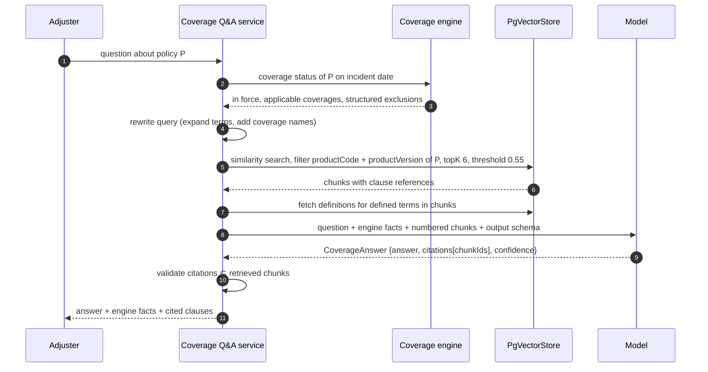

# RAG Architecture

Retrieval Augmented Generation lets the intelligence layer answer questions and justify assessments using the insurer's own policy wordings, product terms, claims procedures, and underwriting guidelines — with citations — instead of the model's general knowledge.

RAG **informs**; it does not decide coverage. The coverage engine is authoritative, and every RAG answer is returned alongside the engine's result (see [AI Decisioning](ai-decisioning.md)).

## What Is Indexed

| Source type | Example | Scoped to |
|---|---|---|
| `POLICY_WORDING` | Motor Comprehensive Policy Wording v3 | Product version |
| `PRODUCT_TERMS` | Schedule of benefits, limits table | Product version |
| `CLAIMS_PROCEDURE` | Motor claims handling manual | Line of business |
| `UNDERWRITING_GUIDELINE` | Motor underwriting guide | Line of business |
| `REGULATORY_GUIDANCE` | Regulator circulars on claims timelines | Global |

Customer data, claims, and documents uploaded for claims are **never** indexed. The vector store contains only non-personal reference material, which keeps retrieval free of cross-customer data leakage by design.

## Storage: pgvector

Embeddings are stored in PostgreSQL with the pgvector extension, in the same database as the domain data ([ADR-0005](../decisions/0005-pgvector-vector-store.md)).

In short, pgvector adds a `vector(n)` column type and distance operators to PostgreSQL, plus approximate nearest-neighbour indexes. A similarity search is an ordinary SQL query:

```sql
SELECT id, content, metadata, embedding <=> :query_embedding AS distance
FROM intelligence.knowledge_chunk
WHERE metadata @> '{"productCode": "MOTOR-COMP", "productVersion": 3, "status": "ACTIVE"}'
ORDER BY embedding <=> :query_embedding
LIMIT 6;
```

`<=>` is cosine distance. Spring AI's `PgVectorStore` generates this query from a `SearchRequest`, so application code does not write it by hand.

Table and index:

```sql
CREATE EXTENSION IF NOT EXISTS vector;

CREATE TABLE intelligence.knowledge_chunk (
    id                    uuid PRIMARY KEY,
    content               text   NOT NULL,
    metadata              jsonb  NOT NULL,
    embedding             vector(1536) NOT NULL,
    knowledge_document_id uuid GENERATED ALWAYS AS ((metadata ->> 'knowledgeDocumentId')::uuid) STORED
        REFERENCES intelligence.knowledge_document (id) ON DELETE CASCADE
);

CREATE INDEX knowledge_chunk_embedding_idx
    ON intelligence.knowledge_chunk USING hnsw (embedding vector_cosine_ops)
    WITH (m = 16, ef_construction = 64);

CREATE INDEX knowledge_chunk_metadata_idx
    ON intelligence.knowledge_chunk USING gin (metadata jsonb_path_ops);
```

The first four columns are the shape `PgVectorStore` expects; the generated column adds referential integrity without the vector store needing to know about it. The schema is created by Flyway, so Spring AI's `initialize-schema` is disabled:

```yaml
spring:
  ai:
    vectorstore:
      pgvector:
        initialize-schema: false
        schema-name: intelligence
        table-name: knowledge_chunk
        index-type: HNSW
        distance-type: COSINE_DISTANCE
        dimensions: 1536
```

Expected scale is small — tens of products with a few versions each, roughly 10,000–100,000 chunks — well within what pgvector with HNSW handles with low-millisecond queries.

## Ingestion

```mermaid
flowchart LR
    upload["Product manager uploads<br/>wording (PDF / DOCX)"] --> doc["document module<br/><i>stored, scanned CLEAN</i>"]
    doc --> kd["POST /knowledge-documents<br/><i>status INGESTING</i>"]
    kd --> job["Worker: ingestion job"]
    job --> read["Read<br/><i>Tika / PDF reader</i>"]
    read --> clean["Normalise<br/><i>headers, footers,<br/>page numbers removed</i>"]
    clean --> split["Structure-aware split<br/><i>by section and clause</i>"]
    split --> meta["Attach metadata"]
    meta --> embed["Embed in batches"]
    embed --> write["Write chunks"]
    write --> swap["Activate:<br/>new ACTIVE, previous SUPERSEDED<br/><i>one transaction</i>"]
```



### Chunking

Policy wordings are structured documents with numbered sections and clauses, and answers must cite them. Chunking follows that structure:

1. Split on section and clause headings (`3.`, `3.1`, `4.2(b)`, `Section 4 – Exclusions`) detected by pattern.
2. Each chunk carries its `sectionPath` (`Section 4 > General Exclusions > 4.2`) and `clauseReference` (`4.2(f)`).
3. Clauses longer than ~800 tokens are split with Spring AI's `TokenTextSplitter` with overlap; each piece keeps the clause reference.
4. Very short clauses are merged with siblings under the same heading up to ~500 tokens.
5. The section heading is prepended to every chunk's text, so a chunk reading "This does not apply where…" still carries its context.

Definitions sections are chunked one definition per chunk and tagged `"isDefinition": true` so a defined term used in a retrieved clause can be fetched alongside it.

### Metadata

```json
{
  "knowledgeDocumentId": "0192e1aa-…",
  "sourceType": "POLICY_WORDING",
  "productCode": "MOTOR-COMP",
  "productVersion": 3,
  "lineOfBusiness": "MOTOR",
  "title": "Motor Comprehensive Policy Wording",
  "sectionPath": "Section 4 > General Exclusions",
  "clauseReference": "4.2(f)",
  "chunkIndex": 57,
  "isDefinition": false,
  "status": "ACTIVE",
  "effectiveFrom": "2026-01-01"
}
```

### Versioning

Product versions are immutable, and so is their wording. A claim is assessed against the wording of the **product version the policy was sold under**, not the latest. A new wording version is ingested as a new knowledge document; activation marks the previous one `SUPERSEDED` (retained for policies sold under it — "superseded" means "not for new products", and retrieval filters by the policy's own product version, not by `ACTIVE`).

`CLAIMS_PROCEDURE` and `UNDERWRITING_GUIDELINE` documents are not tied to product versions; for those, only the `ACTIVE` version is retrieved.

## Retrieval



| Parameter | Value | Notes |
|---|---|---|
| Filter | `productCode`, `productVersion` of the policy, or `lineOfBusiness` + `ACTIVE` for procedures | Prevents answering from the wrong product's wording |
| `topK` | 6 | Tuned with the evaluation set |
| Similarity threshold | 0.55 cosine similarity | Below this, chunks are dropped |
| Query rewrite | Model-assisted rewrite adding insurance terminology, using Spring AI's `RewriteQueryTransformer` | Customer-language questions ("hit a pothole") rarely match wording language ("accidental collision") |
| Definitions | Up to 3 definition chunks for defined terms found in retrieved chunks | |

Implemented with Spring AI's `RetrievalAugmentationAdvisor` (query transformer → `VectorStoreDocumentRetriever` with a filter expression → context augmenter), so the pipeline is composable and each stage is testable.

### Grounding rules

The prompt instructs the model to:

- Answer **only** from the provided clauses and engine facts.
- Cite every statement with chunk numbers.
- Say "the policy wording provided does not address this" when the clauses do not answer the question, and set `requiresHumanInterpretation`.
- Never contradict the engine facts; if a clause appears to conflict with them, report the conflict.

The validator then rejects answers whose citations reference chunks that were not retrieved, and answers with no citations unless they state that the wording does not address the question.

### Retrieved text is untrusted

Wordings are uploaded by staff, but they are still treated as data: chunks are placed in delimited blocks, the system prompt states that instructions inside them are to be ignored, and the RAG-answering client has no tools attached.

## Where RAG Is Used

| Use case | Retrieval scope |
|---|---|
| Coverage Q&A | Policy's product version wording + terms |
| Claim triage | Claims procedure for the line of business (required documents, timelines) |
| Claim risk | Relevant exclusions for the claim's coverages (to surface possible exclusion concerns) |
| Claim summary | Coverage clauses for claimed coverages |
| Underwriting risk | Underwriting guideline for the line of business |
| Claim assistant | Available as a tool (`searchPolicyWording`) rather than automatic |

## Evaluation

A RAG change (chunking, embedding model, `topK`, threshold, prompt) must not ship without running the evaluation set:

- **Retrieval set:** ~100 questions per line of business, each labelled with the clause references that answer it. Metric: recall@6 (target ≥ 0.9).
- **Answer set:** ~50 questions with reference answers reviewed by a claims expert. Metrics: citation accuracy (every cited clause supports the statement), faithfulness (no unsupported claims), and correct "does not address" behaviour on out-of-scope questions.

The evaluation runs in CI against a fixture wording set and as a scheduled job against production wordings.

## Re-embedding

Changing the embedding model changes vector dimensions and meaning; old and new vectors cannot be mixed. Procedure:

1. Create `knowledge_chunk_v2` with the new dimension.
2. Re-ingest all non-superseded documents into it with the worker.
3. Run the evaluation set against v2.
4. Switch `table-name` configuration; drop the old table after a rollback window.
