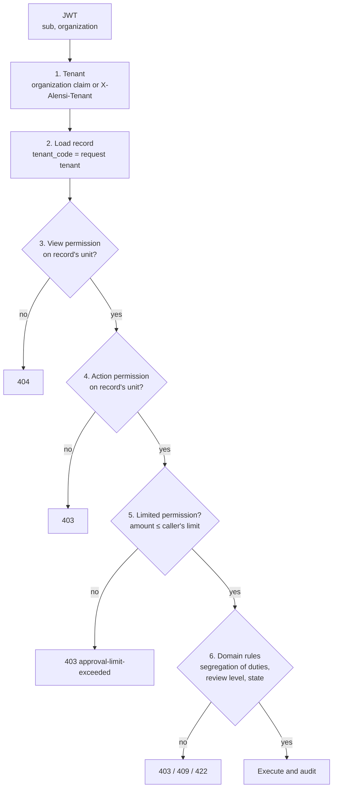

# Authorization and Data Scoping

Who may call each Insure endpoint, and which records and fields they get back. This is the contract between Insure, Alensi Identity, which owns users, roles, grants and approval limits, and Alensi Flow, which calls Insure on behalf of users.

The machine-readable version is the `x-authorization` block on every operation in [openapi.yaml](./openapi.yaml). The [permission matrix](#permission-matrix) below is generated from it.

## Model



| Concept | Owner | Meaning for Insure |
|---|---|---|
| **Tenant** | Identity | An insurer, e.g. `JUB` (Jubilee). Each request acts in exactly one tenant. Every Insure record belongs to one tenant |
| **Target** | Identity | A node in the tenant's hierarchy `company → country → region → branch → team`, e.g. `JUB-KE-NRB-NWS-T1`. A grant on a node covers everything beneath it |
| **Unit** | Insure | The target that owns a record: the selling **team** if there is one, otherwise the **branch**. Stored as `unit_code` |
| **Permission** | Identity catalog | A code registered by application `alensi-insure`, e.g. `claims.approve`. The catalog is `catalog/alensi-insure.json` in alensi-identity |
| **Limited permission** | Identity catalog | A permission with a per-currency amount limit per role, e.g. `claims.approve` up to KES 1,000,000 |
| **Domain rule** | Insure | A check permissions can't express, e.g. "the approver did not assess this claim" |

Insure stores no users, roles or grants ([ADR-0003](../decisions/0003-auth-via-alensi-identity.md)). It uses `alensi-identity-spring-boot-starter`:

```java
access.require("claims.view", claim.unitCode());                              // one record
TargetScope scope = access.scope("claims.view");                              // list queries
Decision d = access.decide("claims.approve", claim.unitCode(), amount, "KES"); // limited, always live
```

Permission maps are cached per user and tenant for 30 seconds, so a revoked grant stops working within 30 seconds. Limit decisions are never cached. If Identity can't answer, the request fails closed with `503`.

## Callers

| Caller | Token | Acts as | Accepted on |
|---|---|---|---|
| Staff, through the web app | User token from `alensi-insure-web` (Authorization Code + PKCE, MFA enforced by Keycloak) | Themselves | Every endpoint |
| Alensi Flow | Service token from client `alensi-flow`, plus `X-Acting-User` | The user who completed the task | Operations marked [`flow-acting-user`](#flow-acting-user) |
| Insure worker | Service token from client `alensi-insure` | `system`, limited to the record that triggered the job | No HTTP endpoints. Writes AI assessments, anomaly flags and extractions |
| Alensi Pay | None (RabbitMQ events) | — | No HTTP endpoints. Payment status events only |

Customers and policyholders don't sign in to Insure v1. A customer portal would need its own Keycloak realm or group and ownership-based rules ("my policies"), never staff roles.

## Tenant Scope

1. The tenant comes from the token's `organization` claim, otherwise the `X-Alensi-Tenant` header, otherwise the caller's only active membership. Identity rejects a tenant the caller isn't an active member of, and Insure returns `403` with problem type `tenant-not-allowed`.
2. Every customer, product, policy, claim, document, AI assessment, anomaly flag, knowledge document and audit event has a `tenant_code`. **Every query filters on it**, including lookups by ID. A record from another tenant is `404`, exactly as if it didn't exist.
3. Unit codes are prefixed with the tenant (`JUB-…`), and Identity only grants targets inside the tenant's subtree, so a grant can never reach another insurer's records. The `tenant_code` filter is a second, independent guard.
4. Events carry `tenantCode`. Consumers must use it. Flow uses it to pick the tenant's process configuration.
5. PostgreSQL **row-level security** enforces the tenant filter a second time, in the database ([below](#row-level-security)).

### Row-Level Security

Decided in [ADR-0009](../decisions/0009-tenant-isolation-row-level-security.md). Application filters are the first barrier. Without a second one, a single query that forgets `tenant_code = ?` leaks another insurer's data. With RLS, PostgreSQL applies the filter itself. A buggy `SELECT * FROM claims.claim` then returns only the current tenant's rows, and inserting or updating a row for another tenant fails.

Every table with a `tenant_code` column gets:

```sql
ALTER TABLE claims.claim ENABLE ROW LEVEL SECURITY;
ALTER TABLE claims.claim FORCE ROW LEVEL SECURITY;      -- applies to the table owner too

CREATE POLICY tenant_isolation ON claims.claim
  USING      (tenant_code = current_setting('app.tenant_code', true))
  WITH CHECK (tenant_code = current_setting('app.tenant_code', true));
```

`current_setting(..., true)` returns `NULL` when the setting is missing, so a transaction that never set a tenant sees **no rows** and can write none. It fails closed rather than erroring halfway through.

**Per transaction.** At the start of each transaction, Insure sets the tenant that `alensi-identity-spring-boot-starter` resolved for the request (`access.tenant()`):

```sql
SELECT set_config('app.tenant_code', :tenant, true);   -- true = transaction-local
```

`set_config(..., true)` behaves like `SET LOCAL`, but takes a bind parameter, so the tenant code is never concatenated into SQL. Being transaction-local, it can't leak to the next request that borrows the pooled connection. The call is made by a transaction-begin hook in `platform.security`, never by individual repositories. A request with no resolved tenant gets no transaction.

**Database roles**

| Role | Used by | RLS |
|---|---|---|
| `insure_owner` | Owns schemas and tables; Flyway migrations only | Has `BYPASSRLS`. Credentials only in the migration job |
| `insure_app` | API and worker at runtime | Not the owner, no `BYPASSRLS`. Subject to every policy |
| `insure_relay` | Outbox relay | Reads and updates `messaging.outbox_event` only (see below) |
| `insure_admin` | Break-glass support and data fixes | `BYPASSRLS`, granted per incident, every session audited |

**Code paths without a user request**

| Path | How the tenant is set |
|---|---|
| Event-driven jobs (AI assessment, extraction) | From the event's `tenantCode`, before loading anything |
| Alensi Pay events | Insure sends `tenantCode` in the payment's `metadata`, and Pay echoes it back on every event. The consumer sets it before looking up the payment reference |
| Schedulers (quote expiry, lapse, renewal-due) | One transaction per tenant: list the active tenants, then set each in turn and process its records. No job runs across tenants in one transaction |
| Outbox relay | `messaging.outbox_event` and `messaging.processed_message` have no RLS. They hold IDs, statuses, amounts and `tenantCode`, never PII, and only `insure_relay` and `insure_app` can reach them |

**Costs and constraints**

- Every table holding tenant data has `tenant_code` leading its indexes (see the [Data Dictionary](../database/data-dictionary.md)), so the policy predicate is cheap.
- pgvector: the HNSW search over `intelligence.knowledge_chunk` is filtered by the policy after the index scan, which can return fewer than `k` chunks. Retrieval enables `hnsw.iterative_scan` so the scan continues until enough rows pass the filter.
- Foreign keys between tenant tables are composite (`tenant_code`, `id`), so a child row can't point at another tenant's parent, even through a bug in the bypass role.
- **CI checks the setup:** a test queries `pg_class` and fails if any table with a `tenant_code` column lacks `relrowsecurity` and `relforcerowsecurity`. A second test runs repositories as `insure_app` with tenant `JUB` against seeded `MAD` data and expects nothing back.

RLS fits Insure well because every request acts in exactly one tenant. Alensi Identity is cross-tenant by design (platform admins, people working for several insurers), so there it can cover only strictly tenant-scoped tables. That's Identity's decision (gap #14 in its access model).

## Record Ownership

Every check is made on a target. This table says which target each record uses.

| Record | Target used for checks | Set from |
|---|---|---|
| Customer | `customer.unit_code` | `unitCode` in the registration request; must be inside the caller's `customers.create` scope |
| Policy | `policy.unit_code` | `unitCode` in the quote request, defaulting to the customer's unit; must be inside the caller's `policies.quote` scope. A renewal keeps the original unit |
| Insured item, coverage, premium schedule, installment, adjustment, payment reference | The policy's unit | Parent |
| Claim | `claim.unit_code` | Copied from the policy at submission, so claims are handled where the policy is serviced |
| Claim item, coverage check, information request, decision, settlement | The claim's unit | Parent |
| Document, extraction | The owner's unit (customer, policy or claim) | Owner |
| AI assessment | The subject's unit (claim or policy) | Subject |
| Anomaly flag | The claim's unit | Claim |
| Product, product version, knowledge document | **Tenant root** (e.g. `JUB`) | Tenant-wide: a product is sold by every branch |
| Audit event | The subject's unit, or the tenant root for tenant-wide subjects | Subject |

Moving a customer or policy to another unit (branch transfer) is not in v1. When added, it will be a command requiring the relevant `update` permission on **both** units.

## Check Types

| `x-authorization` | Check | Example |
|---|---|---|
| `target: customer`, `policy`, `claim`, `document`, `anomaly`, `subject` | `access.require(permission, record.unitCode)` after loading the record | `GET /claims/{id}` needs `claims.view` on the claim's unit |
| `target: body.unitCode` | The unit named in the request must be inside the caller's scope | `POST /customers` with `unitCode: JUB-KE-NRB-NWS` needs `customers.create` there |
| `target: tenant` | Permission on the tenant root. In practice it requires a company-level grant | `PUT …/coverages` needs `coverage.manage` on `JUB` |
| `filter` | `TargetScope` from `access.scope(permission)`, applied in SQL as `unit_code IN (:targets)` (or no unit filter when `all()`). An empty scope returns an empty page, not `403` | `GET /claims` |
| `limit` | `access.decide(permission, unit, amount, currency)`, always live | `POST /claims/{id}/decisions` |
| `anyOf` | Any one of the listed permissions is enough | Claim documents can be uploaded with `claims.submit` or `claims.assess` |

Filters on list endpoints such as `unitCode`, `customerId` or `status` narrow results inside the scope and never widen it. Paging totals count only visible records.

### 404 or 403

| Situation | Response |
|---|---|
| Record doesn't exist, belongs to another tenant, or the caller has **no view permission** on its unit | `404`. Callers can't probe for records they can't see |
| Caller can view the record but lacks the action's permission | `403`, problem type `permission-denied`, naming the missing permission |
| Caller has the permission but the amount exceeds their limit | `403`, problem type `approval-limit-exceeded`, with the caller's limits |
| A domain rule refuses this caller (segregation of duties, review level) | `403`, problem type naming the rule |
| The record's state doesn't allow the action | `409` |

The view permission for each record type is `customers.view`, `policies.view`, `claims.view`, `claims.investigate` (anomaly flags) and `products.view`. Alensi Identity's access-model scenarios describe a Mombasa claim opened from Nairobi as `403`. Insure deliberately returns `404` there.

## Limited Permissions

Identity holds a limit per role, per permission, per currency. A user's effective limit on a target is the highest limit among their grants covering it. No limit configured for a currency means no authority in that currency. A `null` limit means unlimited.

| Permission | Amount checked | Endpoint |
|---|---|---|
| `claims.approve` | `approvedAmount` | `POST /claims/{id}/decisions` |
| `claims.settle` | Settlement `amount` | `POST /claims/{id}/settlements` |
| `policies.underwrite` | The policy's total sum insured, when accepting | `POST /policies/{id}/underwriting-decisions` |
| `premiums.adjust` | Absolute value of the adjustment `amount` | `POST /policies/{id}/premium-adjustments` |

When the amount is above the caller's limit, Insure returns:

```json
{
  "type": "https://alensi.io/problems/approval-limit-exceeded",
  "title": "Approval limit exceeded",
  "status": 403,
  "detail": "Approving KES 3,000,000.00 needs a claims.approve limit of at least that amount on JUB-KE-NRB-NWS.",
  "permission": "claims.approve",
  "requestedAmount": { "amount": "3000000.00", "currency": "KES" },
  "limits": [{ "currency": "KES", "maxAmount": "1000000.00" }]
}
```

Flow should route the approval task by amount in the first place. This response is the backstop when it hasn't, and it tells Flow how far up the chain to go. Insure never escalates on its own.

## Domain Rules

Identity answers "may this person do this here?". These rules answer "may this person do this **to this record**?", and are enforced by Insure on every call, whether it comes from a user or from Flow.

### flow-acting-user

On operations marked with this rule, Alensi Flow may call with its own service token and `X-Acting-User: <identity user id>`. Insure then requires:

1. The service holds `workflows.act` on the record's unit or above.
2. `X-Alensi-Tenant` is present, and the acting user is an active member of that tenant.
3. The **acting user** holds every permission the operation requires, checked by Insure with its service account through `AlensiIdentityClient.permissionsOf(user, token, tenant)`. Limits are checked for the acting user too.
4. All other rules apply to the acting user, not to Flow.

The audit event records `actor_id = alensi-flow`, `on_behalf_of = <acting user>` and the `X-Flow-Task-Id`. On user tokens `X-Acting-User` is rejected with `400`, and on operations without this rule it is ignored. Replacing the header with OAuth2 token exchange is a follow-up in [ADR-0003](../decisions/0003-auth-via-alensi-identity.md).

### segregation-of-duties

| Action | The acting user must not be |
|---|---|
| Record the assessment | The user who submitted the claim |
| Decide the claim | The submitter or the assessor |
| Initiate a settlement | The user who decided the claim |

Problem type `segregation-of-duties`. No permission or role overrides it.

### review-level

The claim's `minimumReviewLevel` (`STANDARD`, `SENIOR`, `INVESTIGATION`) is computed from rules and AI routing signals ([Claim Assessment](../flows/claim-assessment.md#6-routing-signals)), and can be raised by a person with `claims.escalate`. At `SENIOR` or `INVESTIGATION` the decider also needs `claims.approve-senior`, and it applies to rejections as well as approvals. Problem type `review-level-not-met`.

### anomalies-resolved-for-investigation

At `INVESTIGATION` level, every anomaly flag on the claim must be `DISMISSED` or `CONFIRMED` before any decision is recorded. Otherwise the response is `409` with problem type `anomalies-unresolved`.

### review-level-only-increases

An escalation to a level at or below the current one is rejected with `409`. Nothing lowers a claim's review level.

### draft-only

Only `DRAFT` product versions can be changed. Published versions are immutable, and changing one returns `409`.

### uploader-only

Only the user who registered a document can confirm its upload.

## Response Data Scoping

Permission to call an endpoint doesn't mean seeing everything related to the record.

| Data | Rule |
|---|---|
| National ID, tax number | Write-only. Responses show `nationalIdMasked` (`****5678`). Search by national ID hashes the input server-side |
| Payment methods, beneficiary accounts | Never stored or returned. Insure holds only Alensi Pay tokens |
| Embedded records | A claim embeds its policy summary and a policy embeds its customer summary only if the caller can view them. Otherwise the embedded object is `{"id": "…", "restricted": true}` |
| Child lists | `GET /customers/{id}/policies`, `/claims` and `/activity` leave out entries outside the caller's `policies.view` / `claims.view` scope |
| Sensitive documents | `SENSITIVE` (identity documents) and `MEDICAL` documents are listed with their metadata. Downloading them or reading their extractions also needs `documents.sensitive.view` |
| AI evidence | Evidence pointing at a document the caller can't open is returned with `withheld: true` and no excerpt |
| AI assessments | Need `ai.recommendations.view` as well as view permission on the subject. Viewing a full assessment is audited |
| Audit events | Filtered by `audit.view` scope. Tenant-wide events (products, knowledge) need `audit.view` on the tenant root |
| Events on RabbitMQ | IDs, statuses, amounts, `tenantCode` and `unitCode` only. **Never PII.** Consumers fetch details through the API with their own authorization |

## AI Tools

The claim assistant and coverage questions run read-only tools ([Tool Calling](../ai/tool-calling.md)). The tools:

- run **as the calling user**, applying the same checks as the matching endpoint (`claims.view`, `policies.view`, `customers.documents.view`, `documents.sensitive.view`), so the model can never see more than the person asking,
- are limited to the record in scope, so an ID the model makes up or reads in a document is refused,
- never call commands.

Event-driven assessments run as `system`, limited to the record that triggered the job. Their output is readable only through the API, with the checks above.

## Document Permissions by Owner

Document endpoints use the owner's permissions. In `openapi.yaml` these appear as `owner.view`, `owner.upload` and `owner.verify`:

| Owner | `owner.view` (list, download, extractions) | `owner.upload` (register, complete) | `owner.verify` (verify extraction) |
|---|---|---|---|
| Customer | `customers.documents.view` | `customers.documents.upload` | `customers.update` |
| Policy | `policies.view` | `policies.quote` | `policies.issue` |
| Claim | `claims.view` | `claims.submit` or `claims.assess` | `claims.assess` |

`SENSITIVE` and `MEDICAL` documents also need `documents.sensitive.view` to download, or to read extractions.

## Permission Matrix

Generated from `x-authorization` in [openapi.yaml](./openapi.yaml). Paths are relative to `/api/v1`. *On* names the target the permission is checked on (see [Record Ownership](#record-ownership)).

### Session

| Method | Path | Requires (permission on target) | Filter / rules |
|---|---|---|---|
| `GET` | `/me` | — |  |

### Customers

| Method | Path | Requires (permission on target) | Filter / rules |
|---|---|---|---|
| `POST` | `/customers` | `customers.create` on body.unitCode |  |
| `GET` | `/customers` | — | list filtered by `customers.view` |
| `GET` | `/customers/{customerId}` | `customers.view` on customer |  |
| `PATCH` | `/customers/{customerId}` | `customers.update` on customer |  |
| `POST` | `/customers/{customerId}/deactivate` | `customers.update` on customer |  |
| `GET` | `/customers/{customerId}/policies` | `customers.view` on customer | list filtered by `policies.view` |
| `GET` | `/customers/{customerId}/claims` | `customers.view` on customer | list filtered by `claims.view` |
| `GET` | `/customers/{customerId}/activity` | `customers.view` on customer |  |

### Products

| Method | Path | Requires (permission on target) | Filter / rules |
|---|---|---|---|
| `POST` | `/products` | `products.manage` on tenant |  |
| `GET` | `/products` | `products.view` on tenant |  |
| `GET` | `/products/{productId}` | `products.view` on tenant |  |
| `POST` | `/products/{productId}/versions` | `products.manage` on tenant |  |
| `GET` | `/products/{productId}/versions/{versionNumber}` | `products.view` on tenant |  |
| `PUT` | `/products/{productId}/versions/{versionNumber}/rating` | `products.manage` on tenant | [draft-only](#draft-only) |
| `PUT` | `/products/{productId}/versions/{versionNumber}/coverages` | `coverage.manage` on tenant | [draft-only](#draft-only) |
| `PUT` | `/products/{productId}/versions/{versionNumber}/eligibility` | `coverage.manage` on tenant | [draft-only](#draft-only) |
| `POST` | `/products/{productId}/versions/{versionNumber}/publish` | `products.manage` on tenant | [draft-only](#draft-only) |
| `POST` | `/products/{productId}/versions/{versionNumber}/withdraw` | `products.manage` on tenant |  |

### Policies

| Method | Path | Requires (permission on target) | Filter / rules |
|---|---|---|---|
| `POST` | `/policies/quotes` | `policies.quote` on body.unitCode<br>`customers.view` on customer<br>`products.view` on tenant |  |
| `GET` | `/policies` | — | list filtered by `policies.view` |
| `GET` | `/policies/{policyId}` | `policies.view` on policy |  |
| `POST` | `/policies/{policyId}/accept` | `policies.issue` on policy |  |
| `POST` | `/policies/{policyId}/underwriting-decisions` | `policies.underwrite` on policy<br>`policies.underwrite` on policy, limit `policy.totalSumInsured` — when `decision in (ACCEPT, ACCEPT_WITH_LOADING)` | [flow-acting-user](#flow-acting-user) |
| `POST` | `/policies/{policyId}/cancel` | `policies.cancel` on policy |  |
| `POST` | `/policies/{policyId}/reinstate` | `policies.issue` on policy |  |
| `POST` | `/policies/{policyId}/renewals` | `policies.renew` on policy |  |
| `GET` | `/policies/{policyId}/coverages` | `policies.view` on policy |  |
| `GET` | `/policies/{policyId}/coverage-status` | `policies.view` on policy |  |

### Premiums

| Method | Path | Requires (permission on target) | Filter / rules |
|---|---|---|---|
| `GET` | `/policies/{policyId}/premium-schedule` | `premiums.view` on policy |  |
| `POST` | `/policies/{policyId}/premium-adjustments` | `premiums.adjust` on policy, limit `abs(amount)` |  |
| `GET` | `/policies/{policyId}/payments` | `payments.view` on policy |  |
| `POST` | `/installments/{installmentId}/collections` | `payments.record` on policy |  |

### Claims

| Method | Path | Requires (permission on target) | Filter / rules |
|---|---|---|---|
| `POST` | `/claims` | `claims.submit` on policy<br>`policies.view` on policy |  |
| `GET` | `/claims` | — | list filtered by `claims.view` |
| `GET` | `/claims/{claimId}` | `claims.view` on claim |  |
| `POST` | `/claims/{claimId}/items` | `claims.submit` on claim |  |
| `POST` | `/claims/{claimId}/coverage-checks` | `claims.assess` on claim |  |
| `POST` | `/claims/{claimId}/information-requests` | `claims.assess` on claim | [flow-acting-user](#flow-acting-user) |
| `POST` | `/claims/{claimId}/information-requests/{requestId}/fulfil` | `claims.submit` on claim |  |
| `POST` | `/claims/{claimId}/assessment` | `claims.assess` on claim | [flow-acting-user](#flow-acting-user)<br>[segregation-of-duties](#segregation-of-duties) |
| `POST` | `/claims/{claimId}/escalations` | `claims.escalate` on claim | [flow-acting-user](#flow-acting-user)<br>[review-level-only-increases](#review-level-only-increases) |
| `POST` | `/claims/{claimId}/decisions` | `claims.approve` on claim, limit `approvedAmount` — when `decision in (APPROVED, PARTIALLY_APPROVED)`<br>`claims.reject` on claim — when `decision == REJECTED`<br>`claims.approve-senior` on claim — when `claim.minimumReviewLevel in (SENIOR, INVESTIGATION)` | [flow-acting-user](#flow-acting-user)<br>[segregation-of-duties](#segregation-of-duties)<br>[review-level](#review-level)<br>[anomalies-resolved-for-investigation](#anomalies-resolved-for-investigation) |
| `POST` | `/claims/{claimId}/settlements` | `claims.settle` on claim, limit `amount` | [flow-acting-user](#flow-acting-user)<br>[segregation-of-duties](#segregation-of-duties) |
| `POST` | `/claims/{claimId}/withdraw` | `claims.submit` on claim |  |
| `POST` | `/claims/{claimId}/close` | `claims.assess` on claim |  |
| `GET` | `/claims/{claimId}/history` | `claims.view` on claim |  |

### Documents

| Method | Path | Requires (permission on target) | Filter / rules |
|---|---|---|---|
| `POST` | `/customers/{customerId}/documents` | `customers.documents.upload` on customer |  |
| `GET` | `/customers/{customerId}/documents` | `customers.documents.view` on customer |  |
| `POST` | `/policies/{policyId}/documents` | `policies.quote` on policy |  |
| `GET` | `/policies/{policyId}/documents` | `policies.view` on policy |  |
| `POST` | `/claims/{claimId}/documents` | `claims.submit` on claim or `claims.assess` on claim |  |
| `GET` | `/claims/{claimId}/documents` | `claims.view` on claim |  |
| `POST` | `/documents/{documentId}/complete` | `owner.upload` on document | [uploader-only](#uploader-only) |
| `GET` | `/documents/{documentId}/content` | `owner.view` on document<br>`documents.sensitive.view` on document — when `document.sensitivity in (SENSITIVE, MEDICAL)` |  |
| `GET` | `/documents/{documentId}/extractions` | `owner.view` on document<br>`documents.sensitive.view` on document — when `document.sensitivity in (SENSITIVE, MEDICAL)` |  |
| `POST` | `/extractions/{extractionId}/verify` | `owner.verify` on document | [flow-acting-user](#flow-acting-user) |

### Intelligence

| Method | Path | Requires (permission on target) | Filter / rules |
|---|---|---|---|
| `GET` | `/claims/{claimId}/ai-assessments` | `claims.view` on claim<br>`ai.recommendations.view` on claim |  |
| `POST` | `/claims/{claimId}/ai-assessments` | `claims.assess` on claim<br>`ai.recommendations.view` on claim |  |
| `GET` | `/ai-assessments/{assessmentId}` | `subject.view` on subject<br>`ai.recommendations.view` on subject |  |
| `POST` | `/ai-assessments/{assessmentId}/feedback` | `subject.view` on subject<br>`ai.recommendations.view` on subject |  |
| `POST` | `/policies/{policyId}/coverage-questions` | `policies.view` on policy<br>`ai.assist` on policy |  |
| `POST` | `/claims/{claimId}/assistant/messages` | `claims.view` on claim<br>`ai.assist` on claim |  |
| `GET` | `/anomalies` | — | list filtered by `claims.investigate` |
| `GET` | `/anomalies/{anomalyId}` | `claims.investigate` on anomaly |  |
| `POST` | `/anomalies/{anomalyId}/status` | `claims.investigate` on anomaly | [flow-acting-user](#flow-acting-user) |
| `POST` | `/knowledge-documents` | `knowledge.manage` on tenant |  |
| `GET` | `/knowledge-documents` | `knowledge.manage` on tenant |  |
| `POST` | `/knowledge-documents/{knowledgeDocumentId}/supersede` | `knowledge.manage` on tenant |  |

### Audit

| Method | Path | Requires (permission on target) | Filter / rules |
|---|---|---|---|
| `GET` | `/audit-events` | — | list filtered by `audit.view` |

## Catalog Coverage

Every permission this contract uses is in `catalog/alensi-insure.json`, including `claims.approve-senior` (`regional-manager`, `head-of-claims`), `documents.sensitive.view` (claims and underwriting roles), `knowledge.manage` (`product-manager`, `head-of-claims`) and `workflows.act`. `workflows.act` belongs to the `flow-service` role, which only a platform admin can grant, to the `alensi-flow` service account on each insurer's company target.

These catalog permissions have no Insure v1 endpoint:

| Permission | Reason |
|---|---|
| `reports.team`, `reports.branch`, `reports.region`, `reports.company` | Reporting endpoints aren't in v1. When added, the report's level picks the permission and its scope picks the units |
| `workflows.manage` | Configuring review queues and escalation rules belongs to Alensi Flow, which should own this permission |

## Role Walkthrough

Using the default roles from the Identity catalog in tenant `JUB`:

| Who | Grant | Request | Result |
|---|---|---|---|
| Agent | `agent` on `JUB-KE-NRB-NWS-T1` | `POST /policies/quotes` with `unitCode: JUB-KE-NRB-NWS-T1` | `201` |
| Agent | same | `POST /policies/{id}/accept` | `403`: `agent` lacks `policies.issue`, so a team lead accepts |
| Agent | same | `GET /claims/{id}` for a Mombasa claim | `404` |
| Branch manager | `branch-manager` on `JUB-KE-NRB-NWS` | `GET /claims` | Claims of Nairobi West and its teams only |
| Branch manager | same | Approve KES 3,000,000 | `403 approval-limit-exceeded`, limit KES 1,000,000. Flow routes to the regional manager |
| Regional manager | `regional-manager` on `JUB-KE-NRB` | Approve the same claim | `201` (limit KES 5,000,000) |
| Claims officer | `claims-officer` on `JUB-KE` | Approve a claim they assessed | `403 segregation-of-duties` |
| Claims officer | same | Approve a claim at `SENIOR` level | `403 review-level-not-met`: needs `claims.approve-senior` |
| Finance officer | `finance-officer` on `JUB-KE-NRB-NWS` | Settle KES 2,500,000 | `403 approval-limit-exceeded` (limit KES 2,000,000) |
| Product manager | `product-manager` on `JUB` | `PUT /products/{id}/versions/3/coverages` on a published version | `409 draft-only` |
| Anyone in Jubilee | Any | `GET /policies/{id}` for a Madison policy | `404` |

## Open Questions

| # | Question | Current position |
|---|---|---|
| 1 | Should agents see only the records they created? Identity's access model mentions an ownership rule (`agent_id = caller`), with senior agents seeing their whole team | v1 scopes by unit only. Adding it needs a catalog permission such as `records.team.view` to tell the ranks apart |
| 2 | Should `GET` on a record outside the caller's scope be `404` (Insure) or `403` (Identity's scenarios)? | `404`, to avoid leaking existence. The Identity doc should be aligned |
| 3 | Grants with `valid_from` / `valid_until` for acting cover during leave | Waiting on Identity (gap #5 in its access model). Insure needs no change, because it asks Identity on every check |
