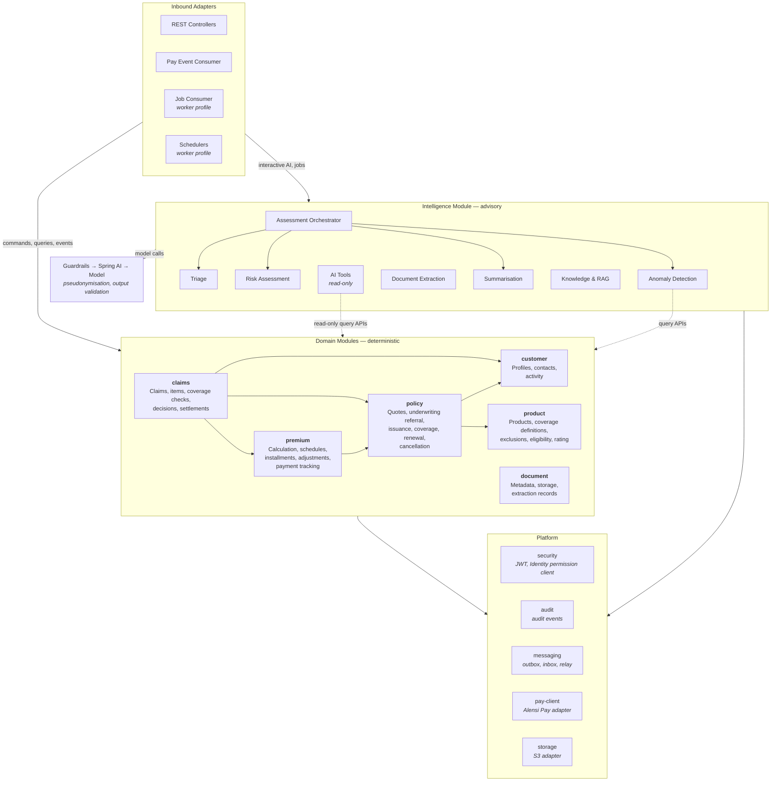

# Component Diagram

This is the C4 level-3 view: the modules inside the Insure application, what each owns, and which way dependencies are allowed to point.

## Modules



## Dependency Rules

1. **Domain modules never depend on the intelligence module.** A claim can be submitted, checked, decided, and settled with the intelligence module switched off. The intelligence module reacts to domain events and reads domain data through each module's published query API.
2. **Upstream-only dependencies between domain modules.** The order is `customer`, `product` → `policy` → `premium` → `claims`. `document` has no domain dependencies; its owners are referenced by type and ID.
3. **Modules talk through a module's public API package**, never its repositories or entities. Each module exposes `api` (commands and queries, as Java interfaces and records) and `events` (published event records). Everything else is package-private.
4. **Modules write only their own schema.** Read access across schemas is only through the owning module's query API.
5. **Platform components are shared**, have no domain knowledge, and may be used by any module.

These rules are enforced in the build with Spring Modulith's module verification test, so a violation fails CI rather than being caught in review.

## Module Responsibilities

### customer

Customer profiles (individual and organisation), contact details, branch ownership, and the customer activity timeline (a read model built from other modules' events). Sensitive identifiers (national ID, tax number) are stored encrypted with a separate searchable hash.

### product

Versioned insurance products. A product version is immutable once published; changes create a new version. Owns coverage definitions, exclusions (structured and textual), eligibility rules, and rating factors. Publishing a product version can register its policy wording with the knowledge base for RAG.

### policy

The policy aggregate: application, eligibility evaluation, underwriting referral, quote, acceptance, issuance, insured items, policy coverages with remaining limits, cancellation, lapse, expiry, and renewal. Owns the **policy state machine**. Calls `premium` to price a quote.

### premium

Deterministic premium calculation from product rating factors, premium schedules and installments, adjustments, and **payment references** — Insure's record of each Alensi Pay payment (collections and payouts) and its last known status. Consumes Pay events. Decides whether a policy's premium is in good standing for coverage purposes.

### claims

The claim aggregate: submission, claim items, coverage checks (authoritative rule evaluation with a trace), information requests, adjuster assessments, decisions, settlements, withdrawal, and closure. Owns the **claim state machine** and limit consumption on policy coverages. Settlements are paid through `pay-client`.

### document

Document metadata, upload and download (presigned URLs), virus-scan status, sensitivity classification, and the record of extraction results and their human verification. Documents belong to a customer, policy, or claim.

### intelligence

Everything that uses a model. Split into capabilities:

| Component | Responsibility |
|---|---|
| Assessment orchestrator | Reacts to claim events, decides which assessments to run, stores results, publishes `insure.ai.assessment-completed` |
| Triage | Category, priority, complexity, missing information, recommended review path |
| Risk assessment | Explainable risk score and classification from deterministic features plus model reasoning |
| Anomaly detection | Deterministic and statistical detectors producing anomaly flags; the model only explains them |
| Document extraction | Text extraction and structured field extraction from uploaded documents |
| Summarisation | Adjuster-facing claim summaries |
| Knowledge & RAG | Ingestion, chunking, embedding, retrieval over policy wordings and procedures (pgvector) |
| AI tools | Read-only tools that let a model fetch scoped claim and policy data |
| Guardrails | Pseudonymisation of prompts, structured output validation, bounds checks, prompt versioning |

See [Intelligence Architecture](../ai/intelligence-architecture.md).

### Platform

| Component | Responsibility |
|---|---|
| security | OAuth2 resource server configuration, `alensi-identity-spring-boot-starter` (`AlensiAccess`: record checks, list scopes, approval limits), tenant resolution, acting-user resolution for Flow calls |
| audit | Append-only audit events with actor, action, subject, correlation ID |
| messaging | Transactional outbox, outbox relay to RabbitMQ, inbox (processed messages) for idempotent consumption |
| pay-client | REST client for Alensi Pay with idempotency keys, timeouts, retries, and circuit breaker |
| storage | S3 client, presigned URL generation, server-side encryption |

## Package Layout

```text
io.alensi.insure
├── customer
│   ├── api          # CustomerQueries, CustomerCommands, DTO records
│   ├── events       # CustomerRegistered, ...
│   └── internal     # entities, repositories, services, controllers
├── product
├── policy
├── premium
├── claims
├── document
├── intelligence
│   ├── assessment
│   ├── triage
│   ├── risk
│   ├── anomaly
│   ├── extraction
│   ├── summary
│   ├── knowledge
│   ├── tools
│   └── guardrails
└── platform
    ├── security
    ├── audit
    ├── messaging
    ├── payclient
    └── storage
```
