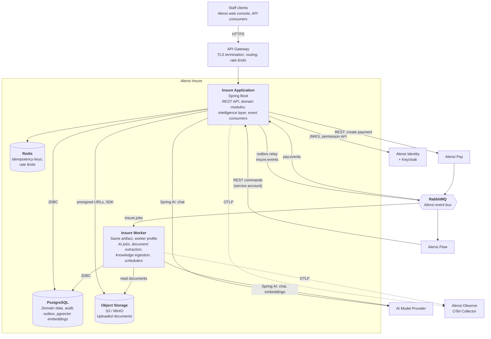

# Container Diagram

This is the C4 level-2 view: the deployable units and data stores that make up Alensi Insure, and how they talk to the rest of the platform.

## Containers

### Insure Application

A single Spring Boot application organised as a **modular monolith** ([ADR-0001](../decisions/0001-modular-monolith.md)). It serves the REST API, runs the domain modules, consumes Pay events, and relays outbox events to RabbitMQ.

Interactive AI requests — coverage questions and the claim assistant — run here because a user is waiting for them. They have strict timeouts and degrade to "AI unavailable" rather than failing the request.

### Insure Worker

The **same artifact** started with the `worker` profile. It takes no HTTP traffic. It consumes the `insure.jobs` queue and runs:

- Claim triage, risk assessment, anomaly explanation, and summarisation after claim events
- Document text extraction and structured extraction
- Knowledge document chunking and embedding
- Scheduled jobs: installment due/overdue detection, policy lapse, renewal offers, quote expiry

Keeping slow and model-bound work off the API pods means a slow or failing AI provider cannot exhaust the API's thread pool, and the two can be scaled independently. Using one artifact avoids a second codebase and keeps module boundaries identical in both.

### PostgreSQL

One database, one schema per module (`customer`, `product`, `policy`, `premium`, `claims`, `document`, `intelligence`, `audit`, `messaging`). Module schemas are owned by their module; cross-module foreign keys are allowed only toward upstream modules (see [Component Diagram](component-diagram.md)).

The **pgvector** extension stores embeddings for policy wordings and procedures in `intelligence.knowledge_chunk` ([ADR-0005](../decisions/0005-pgvector-vector-store.md)). Schema changes are managed with Flyway.

### Redis

Short-lived, reconstructible state only:

| Key space | Purpose | TTL |
|---|---|---|
| `idem:{client}:{key}` | Idempotency-Key replay protection for POST requests | 24 h |
| `rl:ai:{user}` | Per-user rate limit for interactive AI endpoints | 1 min window |

Losing Redis degrades performance; it never loses data. Identity permission maps are cached in-process by `alensi-identity-spring-boot-starter` (30 s per user and tenant), not in Redis.

### Object Storage

Documents are stored in S3 (MinIO locally) under `documents/{ownerType}/{ownerId}/{documentId}`, encrypted at rest with server-side encryption. The database holds only metadata and a SHA-256 hash. Clients upload and download through short-lived presigned URLs issued after a permission check ([ADR-0008](../decisions/0008-document-object-storage.md)).

### RabbitMQ

The shared Alensi event bus. Insure uses:

| Exchange / queue | Type | Direction | Contents |
|---|---|---|---|
| `insure.events` | topic exchange | publish | Domain events (`insure.claim.submitted`, `insure.policy.issued`, …) consumed by Flow and by Insure's own worker |
| `insure.jobs` | queue | internal | Intelligence and document jobs, bound to `insure.events` routing keys |
| `insure.pay-events` | queue | consume | Bound to Pay's `pay.events` exchange for `pay.payment.*` events whose `sourceSystem` is `alensi-insure` |
| `*.dlq` | queues | — | Dead-letter queues after retry exhaustion |

Events are written to an outbox table in the same transaction as the state change and relayed asynchronously ([ADR-0007](../decisions/0007-transactional-outbox.md)). Consumers are idempotent through a processed-message table.

## Communication Summary

| From | To | Style | Why |
|---|---|---|---|
| Client | Insure | Synchronous REST | Users need immediate results for CRUD and commands |
| Flow | Insure | Synchronous REST | Flow needs to know whether a command (e.g. record decision) succeeded |
| Insure | Flow | Asynchronous events | Insure does not need to know which processes react to a claim being submitted |
| Insure | Pay | Synchronous REST + idempotency key | Insure needs Pay's payment ID immediately to track it |
| Pay | Insure | Asynchronous events | Payment outcomes arrive later, from external providers |
| Insure | Identity | Synchronous REST, cached | Authorization must be decided before the request proceeds |
| Insure | AI provider | Synchronous HTTPS, timeouts | Called from worker jobs or bounded interactive requests |

## Deployment

Deployment follows the Alensi Observe paved path: container image built by GitHub Actions, deployed to Kubernetes with Helm, infrastructure provisioned with Terraform on AWS (RDS PostgreSQL with pgvector, ElastiCache Redis, S3, Amazon MQ for RabbitMQ or a self-hosted cluster).

| Workload | Replicas (baseline) | Scaling signal |
|---|---|---|
| `insure-api` | 2+ | CPU, request latency |
| `insure-worker` | 1+ | `insure.jobs` queue depth |

Locally, `docker compose` provides PostgreSQL (with pgvector), Redis, RabbitMQ, MinIO, and the Identity stack.
