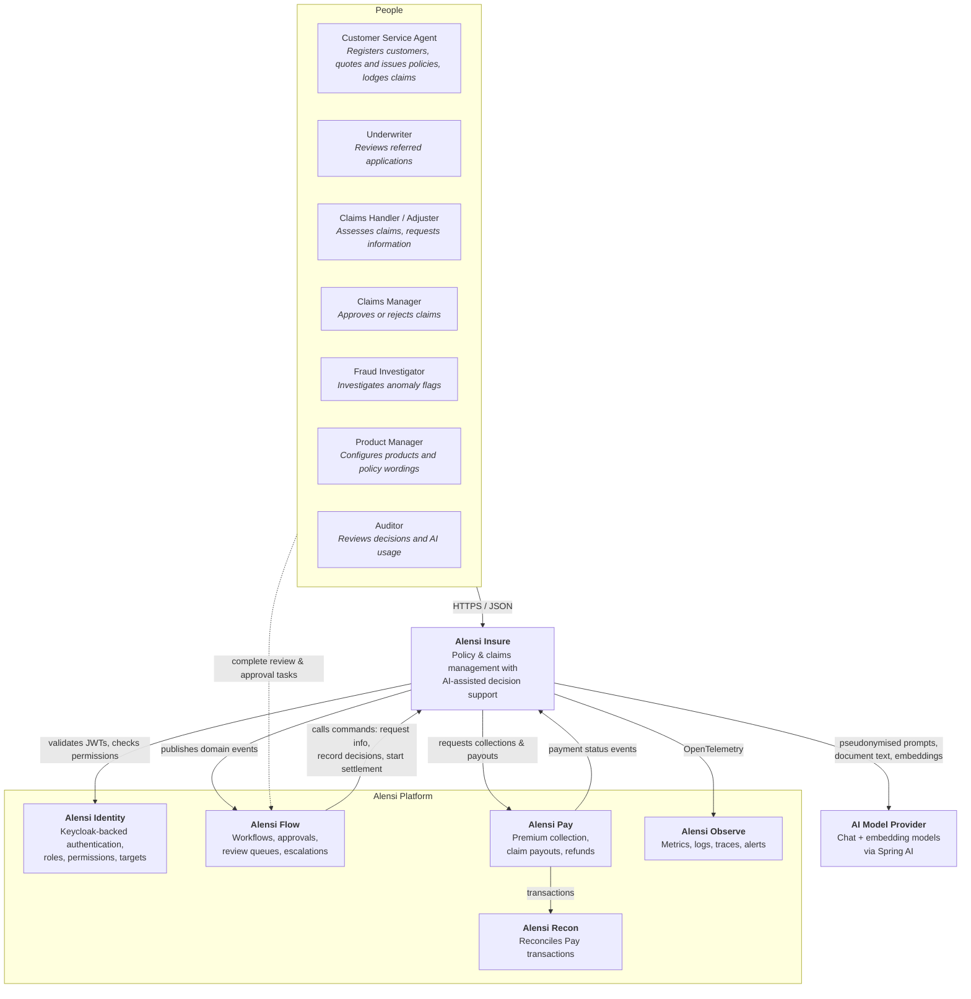

# System Context

This is the C4 level-1 view: Alensi Insure as a single box, the people who use it, and the systems it depends on.

## Users

Insure is a **staff-facing** system in its first version. Every user is an Alensi Identity user, a member of one or more insurers (tenants), with roles granted on targets in that insurer's hierarchy (company, country, region, branch, team). Roles and permissions come from Identity's `alensi-insure` catalog; see [Authorization and Data Scoping](../api/authorization.md).

| Actor (Identity role) | Main activities | Key permissions |
|---|---|---|
| Agent, team lead, customer service (`agent`, `team-lead`, `customer-service`) | Register customers, quote and issue policies, lodge claims, upload documents | `customers.create`, `policies.quote`, `policies.issue`, `claims.submit` |
| Underwriter (`underwriter`, `senior-underwriter`) | Review referred applications, accept or decline risk | `policies.underwrite` (limited by sum insured) |
| Claims adjuster (`claims-adjuster`) | Assess claims, record assessed amounts, request information, read AI outputs | `claims.assess`, `ai.recommendations.view` |
| Claims approver (`claims-officer`, `branch-manager`, `regional-manager`, `head-of-claims`) | Approve, partially approve, or reject claims | `claims.approve` (limited by amount), `claims.reject` |
| Finance (`finance-officer`) | Premium adjustments, collections, claim payouts | `premiums.adjust`, `payments.record`, `claims.settle` (limited by amount) |
| Claims investigator (`claims-investigator`) | Investigate and resolve anomaly flags | `claims.investigate` |
| Product manager (`product-manager`) | Configure products, coverages, rating, and policy wordings for RAG | `products.manage`, `coverage.manage`, `knowledge.manage` |
| Auditor (`auditor`) | Read-only access to decisions, AI assessments, and audit trail | `audit.view` |

Human tasks — "review this referred application", "approve this claim" — are presented and tracked by **Alensi Flow**. The user completes the task in Flow; Flow calls Insure to record the outcome. Insure never maintains its own review queues. See [ADR-0002](../decisions/0002-workflow-orchestration-in-alensi-flow.md).

A customer self-service portal is out of scope for the first version. When one is added it will be a separate client application using the same API with customer-scoped permissions.

## External Systems

| System | Direction | Interaction | Protocol |
|---|---|---|---|
| **Alensi Identity** | Insure → Identity | Insure is an OAuth2 resource server validating Keycloak-issued JWTs (realm `alensi`, audience `alensi-insure`). Fine-grained permission checks are delegated to Identity's permission API. | OIDC / JWT, REST |
| **Alensi Flow** | Both | Insure publishes domain events that start or advance Flow processes. Flow calls Insure's command endpoints as a service account, naming the acting user. | RabbitMQ, REST |
| **Alensi Pay** | Both | Insure requests premium collections and claim payouts with idempotency keys. Pay publishes payment status events that Insure consumes to update installments and settlements. | REST, RabbitMQ |
| **Alensi Recon** | None directly | Recon reconciles Pay's transactions against provider statements and ledgers. Insure's payment references carry Pay's payment IDs so a reconciliation exception can be traced back to a policy or claim. | — |
| **Alensi Observe** | Insure → Observe | Traces, metrics, and logs via OpenTelemetry; AI latency, token, and failure metrics. | OTLP |
| **AI model provider** | Insure → provider | Chat completion (structured output, tool calling) and embedding models through Spring AI. Only pseudonymised, minimised data is sent. | HTTPS |

## Boundaries

What Insure **does**:

- Holds the authoritative record of customers, products, policies, coverage, premiums, claims, decisions, and settlements.
- Enforces insurance business rules deterministically: eligibility, premium calculation, coverage checks, claim state transitions, limit consumption.
- Produces advisory intelligence — triage, risk scores, anomaly flags, document extractions, summaries, policy-grounded answers — and records how each was produced.

What Insure **does not do**:

- Authenticate users or store passwords, roles, or grants (Identity).
- Decide *who* reviews something, *when* it escalates, or *how many* approvals it needs (Flow).
- Move money, talk to payment providers, or reconcile (Pay, Recon).
- Let an AI output become a business decision without a human (see [AI Decisioning](../ai/ai-decisioning.md)).
