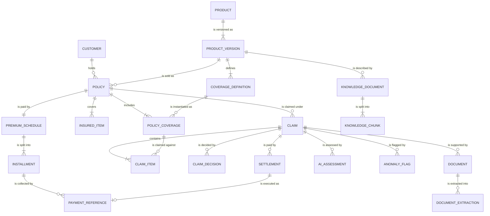
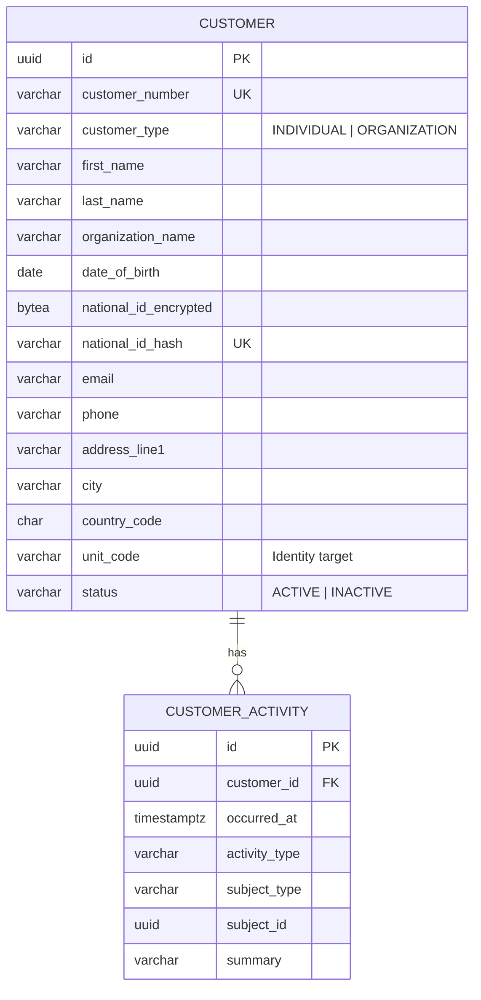
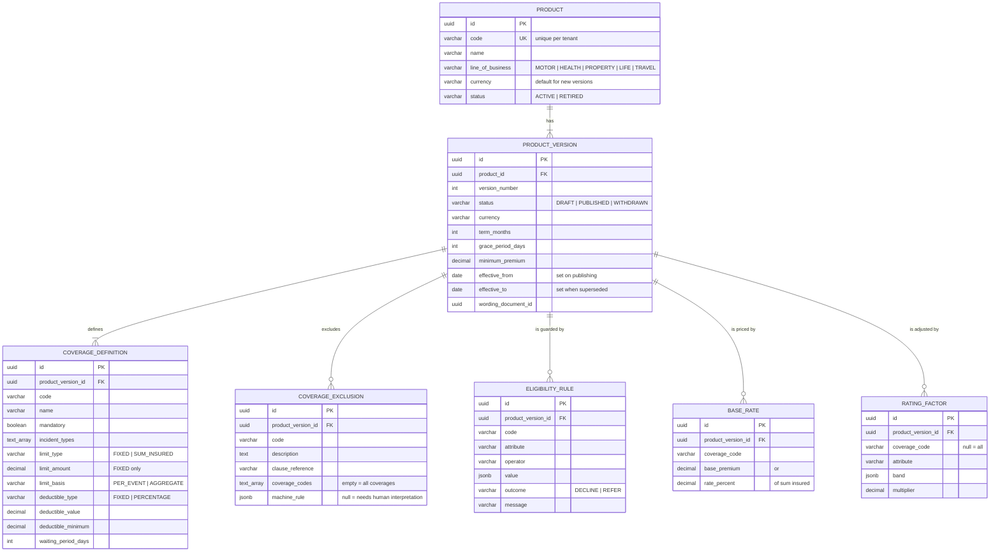
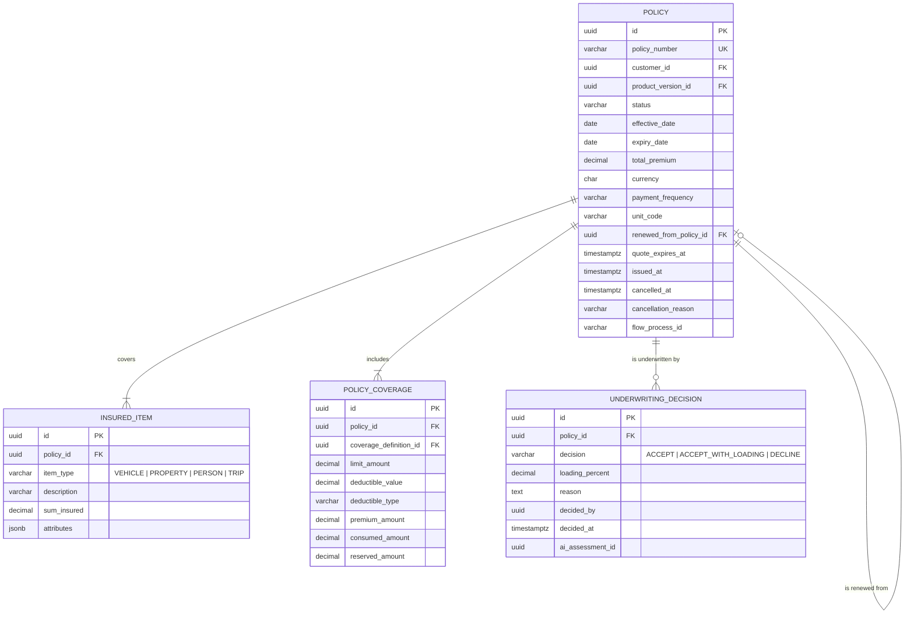
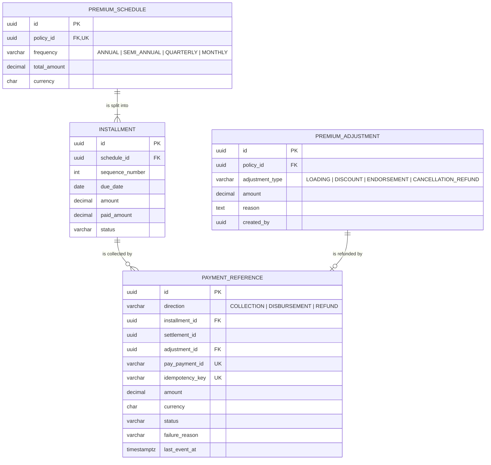
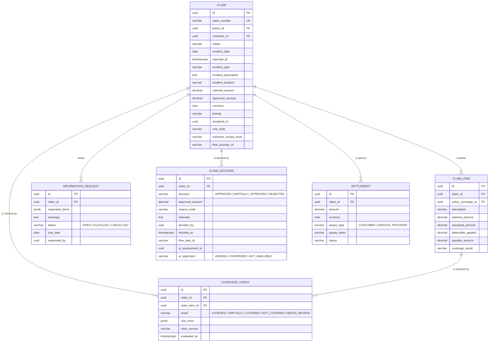
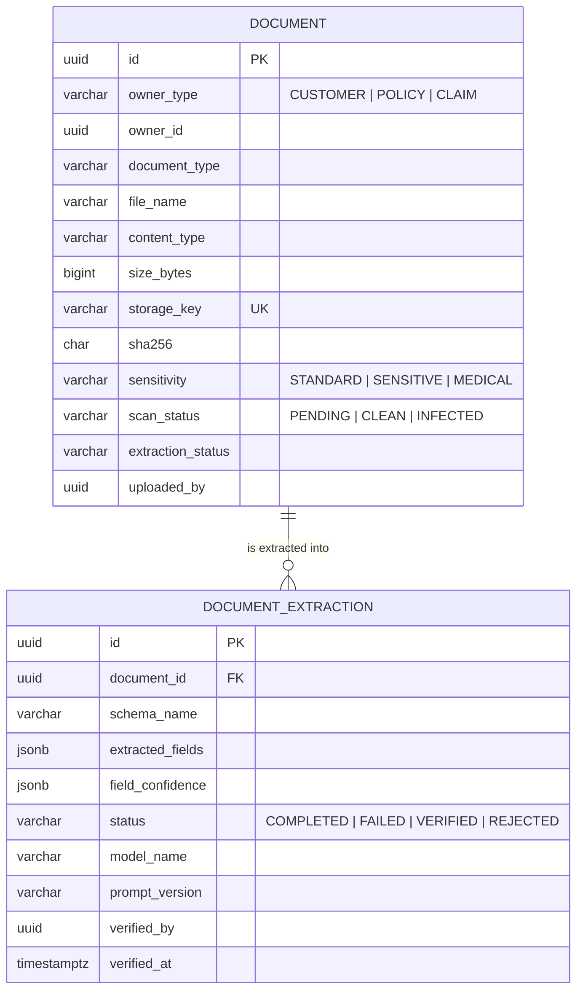
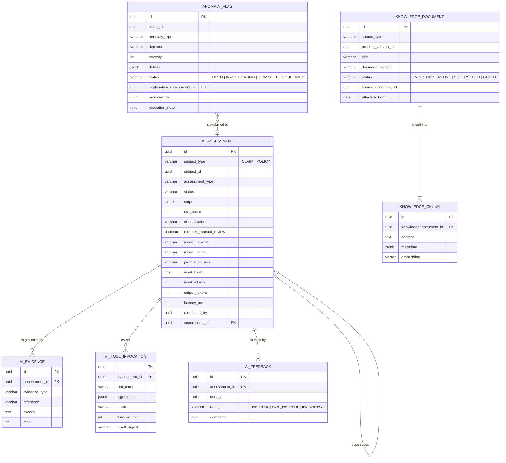
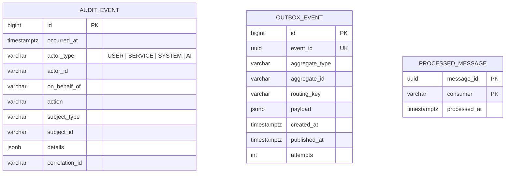

# Entity Relationship Diagram

The database is PostgreSQL with one schema per module. Diagrams are split by module for readability; the overview shows how the modules connect. Column-level detail — types, nullability, enums, and constraints — is in the [Data Dictionary](data-dictionary.md).

Conventions used below:

- Primary keys are UUIDs (v7, time-ordered) unless stated otherwise.
- Money is `decimal(19,4)` paired with an ISO 4217 `currency` column on the owning record.
- Every mutable aggregate root has a `version` column for optimistic locking, plus `created_at` / `updated_at`. These are omitted from the diagrams.
- Cross-schema foreign keys only point upstream: `customer`, `product` → `policy` → `premium` → `claims`. The `intelligence` and `document` schemas reference domain records by ID without database foreign keys, so the domain schemas can be migrated independently of them.

## Overview

## Customer

## Product

## Policy

## Premium

## Claims

## Document

## Intelligence

## Audit and Messaging

These tables have no foreign keys by design: audit and messaging records must survive deletion or archival of the records they describe.
