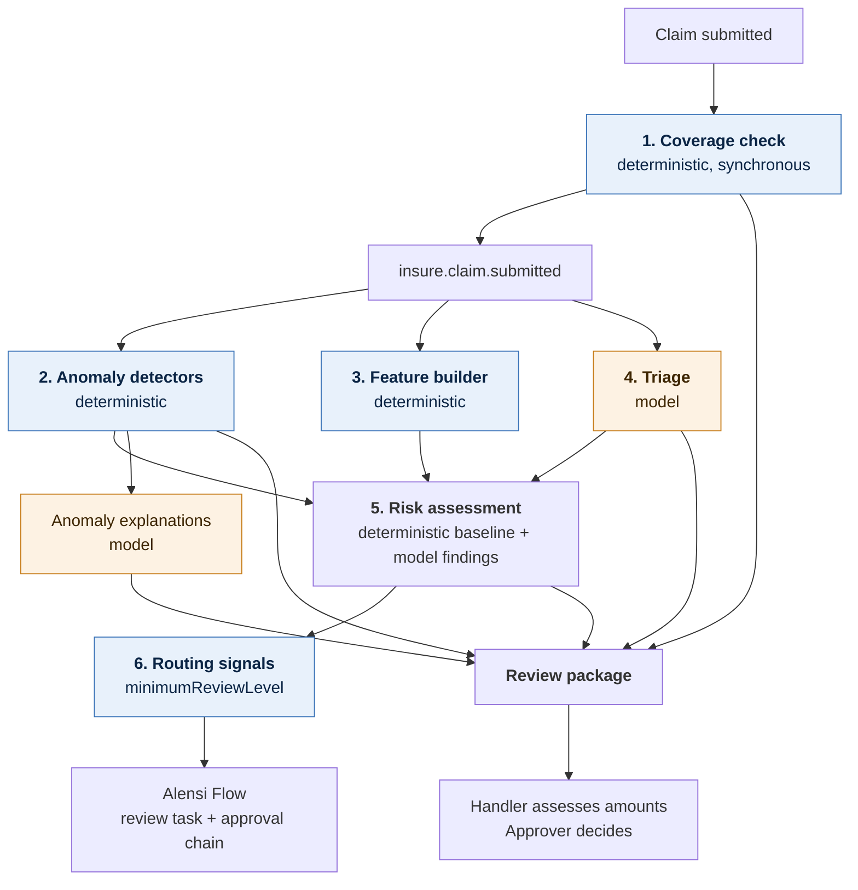
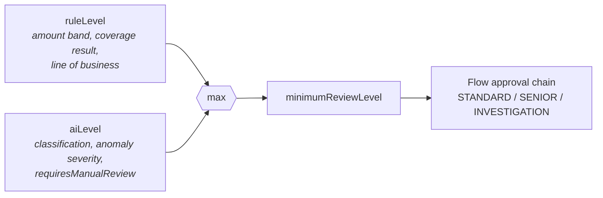

# Claim Assessment

How a submitted claim is assessed: the deterministic coverage check, the advisory intelligence pipeline, how they are combined into a review package, and how that package influences routing in Alensi Flow.



Blue steps are deterministic and authoritative. Orange steps use a model and are advisory. Risk assessment mixes both in a controlled way.

## 1. Coverage Check

Runs synchronously on submission, again on every item change, and on demand (`POST /claims/{id}/coverage-checks`). Rules run in order; each appends to the `rule_trace`. The same code backs the `checkCoverage` AI tool.

### Claim-level rules

| # | Rule | Fails → |
|---|---|---|
| C1 | Policy was `ACTIVE` on the incident date (status periods, excluding lapse periods) | `NOT_COVERED` |
| C2 | Incident date within `effective_date`..`expiry_date` / `cancelled_at` | `NOT_COVERED` |
| C3 | Premium in good standing on the incident date (no installment overdue beyond grace) | `NOT_COVERED` |
| C4 | Reported within the product's notification window | `NEEDS_REVIEW` (late reporting is usually not an automatic rejection) |

### Item-level rules

| # | Rule | Fails → |
|---|---|---|
| I1 | Item's coverage is on the policy | `NOT_COVERED` |
| I2 | Claim's incident type is in the coverage's `incident_types` | `NOT_COVERED` |
| I3 | Waiting period elapsed: `incident_date ≥ effective_date + waiting_period_days` | `NOT_COVERED` |
| I4 | Structured exclusions (`machine_rule` not null) evaluated against facts | `NOT_COVERED` for the item |
| I5 | Textual exclusions (`machine_rule` null) exist for the coverage | Adds context; result `NEEDS_REVIEW` only if triage or the handler marks one as potentially applicable |
| I6 | Remaining limit > 0 | `NOT_COVERED` (`LIMIT_EXHAUSTED`) |
| I7 | Claimed amount ≤ remaining limit | `PARTIALLY_COVERED` |

The claim-level result is the worst of the claim rules; each item's result combines claim and item rules.

Example `rule_trace` entry:

```json
{ "rule": "I3_WAITING_PERIOD", "input": { "effectiveDate": "2026-10-01", "waitingPeriodDays": 30, "incidentDate": "2026-10-19" }, "outcome": "FAIL", "message": "Incident occurred 18 days after inception; waiting period is 30 days." }
```

A `NOT_COVERED` result does **not** reject the claim. Rejection is a human decision; the result is the basis for it, and the handler can see exactly which rule failed.

## 2. Anomaly Detectors

Deterministic detectors run in the worker and create `anomaly_flag` rows. Definitions are in the [Data Dictionary](../database/data-dictionary.md#anomaly-types). Each flag stores the facts that triggered it (`details`), so an investigator does not depend on a model to understand it.

After detectors run, the model is asked to explain each new flag in plain language and suggest checks (`AnomalyExplanation`) — it does not create or score flags.

A new flag publishes `insure.anomaly.flagged`; Flow can open an investigation task in parallel with the claim review.

## 3. Features

Computed from domain data, stored as `FEATURE` evidence on the risk assessment:

| Feature | Definition |
|---|---|
| `amountRatio` | Claimed amount ÷ mean settled amount for the same coverage and product over 24 months |
| `claimFrequency12m` | Claims by the customer in the previous 12 months |
| `inceptionDays` | Days from policy effective date (or reinstatement) to incident |
| `reportingDelay` | Days from incident to report, relative to the procedure window |
| `missingDocuments` | Required documents (from the claims procedure for the incident type) not yet uploaded |
| `anomalySeverity` | Sum of open anomaly flag severities |
| `coverageResult` | Claim-level coverage result |

## 4. Triage

The model receives the pseudonymised claim, coverage result, document list with verified extraction fields, and the claims procedure for the incident type (RAG). It returns `ClaimTriage`: category, recommended priority, complexity, missing information, recommended review path, and reasons.

Its output is used to:

- Show the handler a checklist of missing items, each linked to the procedure clause that requires it.
- Pre-fill (not send) an information request the handler can edit and send.
- Recommend a priority, shown next to the rule-assigned priority.

## 5. Risk Assessment

Runs after detectors, features, and triage. Combines the deterministic baseline with bounded model findings as defined in [AI Decisioning — Risk Score](../ai/ai-decisioning.md#risk-score), and stores `riskScore`, `classification`, `reasons`, `requiresManualReview`, and evidence.

## 6. Routing Signals

Insure computes `minimumReviewLevel = max(ruleLevel, aiLevel)` and publishes it. Flow's claim process uses it together with its own configuration to pick the approval chain.



| Condition | `ruleLevel` |
|---|---|
| Approved amount ≤ branch threshold and coverage `COVERED` | `STANDARD` |
| Above threshold, or `NEEDS_REVIEW`, or `PARTIALLY_COVERED` | `SENIOR` |

| Condition | `aiLevel` |
|---|---|
| `LOW_RISK`, no open flags with severity ≥ 3 | `STANDARD` |
| `REVIEW_REQUIRED` or `requiresManualReview` | `SENIOR` |
| `HIGH_RISK` or any open flag with severity ≥ 4 | `INVESTIGATION` |

Thresholds are configuration owned by the claims team. Flow can always route **higher** than `minimumReviewLevel`, never lower. Insure stores the level on the claim (`claims.claim.minimum_review_level`) and enforces it when the decision is recorded, so a misconfigured process cannot bypass it:

| Level | Insure requires of the deciding user |
|---|---|
| `STANDARD` | `claims.approve` within their amount limit, or `claims.reject` |
| `SENIOR` | As `STANDARD`, plus `claims.approve-senior` |
| `INVESTIGATION` | As `SENIOR`, and every anomaly flag on the claim `DISMISSED` or `CONFIRMED` |

The level only ever increases during a claim's life; re-assessment cannot lower it. A person with `claims.escalate` can raise it (`POST /claims/{id}/escalations`). See [Authorization](../api/authorization.md#review-level).

## Re-assessment

The pipeline re-runs (new assessments supersede old ones) when:

- `insure.claim.information-received` — new documents or details
- `insure.document.extracted` and verified — new facts
- A handler requests it (`POST /claims/{id}/ai-assessments`, rate-limited)

Coverage checks re-run whenever items change. Decisions always record which assessment was displayed.

## Failure Behaviour

| Failure | Effect |
|---|---|
| Model unavailable | Triage, explanations, and model findings missing. Risk score = baseline only, marked `"modelFindings": "UNAVAILABLE"`. `aiLevel` from baseline classification. Review proceeds |
| Detectors fail | Retried; if dead-lettered, the claim is marked for `SENIOR` review (fail toward scrutiny) |
| Coverage engine fails | Submission fails with `500` — the coverage check is part of the domain transaction and must not be skipped |
