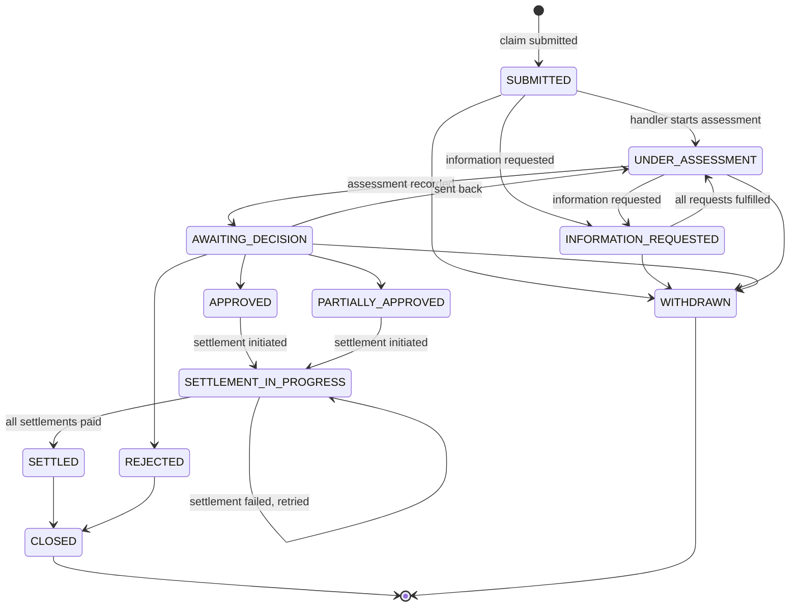
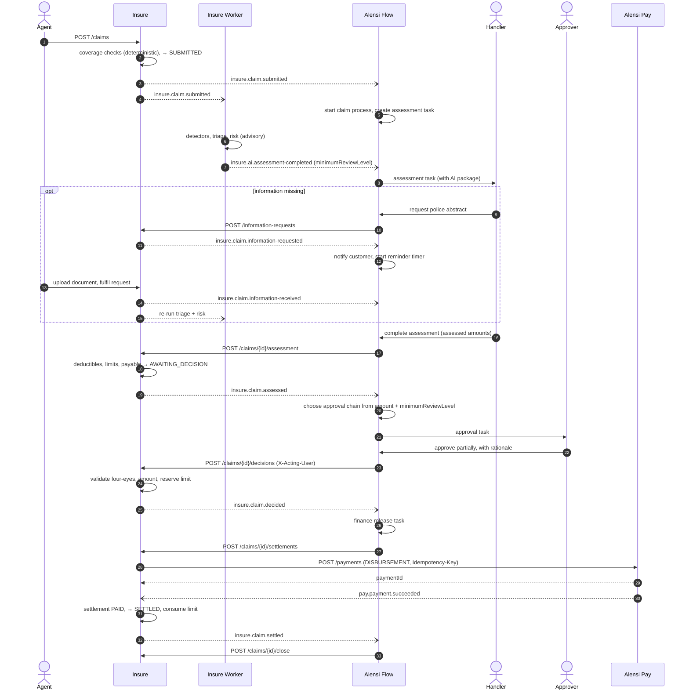

# Claim Lifecycle

From first notification to closure: states, transitions, and the division of work between Insure, Alensi Flow, and Alensi Pay.

| Responsibility | Owner |
|---|---|
| Claim states, legal transitions, coverage checks, limits, payable amounts, decision records | **Insure** |
| Review queues, task assignment, approval chains, escalations, reminders, SLAs, notifications | **Flow** |
| Payout execution | **Pay** |
| Assessments, triage, risk, anomaly explanation (advisory) | **Insure intelligence layer** |

## States

## Transitions

| From → To | Command | Typical actor | Rules enforced by Insure | Event |
|---|---|---|---|---|
| — → `SUBMITTED` | `POST /claims` | Agent | Policy exists and belongs to the customer; at least one item; each item's coverage belongs to the policy; incident date not in the future; claim-level coverage checks run and stored (claim is recorded even if not covered) | `insure.claim.submitted` |
| `SUBMITTED` → `UNDER_ASSESSMENT` | Implicit on first assessment action, or Flow task claimed | Handler via Flow | — | — |
| → `INFORMATION_REQUESTED` | `POST /claims/{id}/information-requests` | Handler via Flow | At least one requested item | `insure.claim.information-requested` |
| `INFORMATION_REQUESTED` → `UNDER_ASSESSMENT` | `POST …/information-requests/{id}/fulfil` (last one) | Agent | All requests `FULFILLED` or `CANCELLED` | `insure.claim.information-received` |
| `UNDER_ASSESSMENT` → `AWAITING_DECISION` | `POST /claims/{id}/assessment` | Handler via Flow | Every item has an assessed amount and a coverage result other than `PENDING`; deductibles and payable amounts computed; no open information requests | `insure.claim.assessed` |
| `AWAITING_DECISION` → `UNDER_ASSESSMENT` | Flow "send back" calls `POST /claims/{id}/information-requests` or re-opens assessment | Approver via Flow | Reason required | — |
| `AWAITING_DECISION` → decision state | `POST /claims/{id}/decisions` | Approver via Flow | Acting user holds `claims.approve` with a limit covering `approvedAmount` (or `claims.reject`), plus what the claim's `minimum_review_level` requires (see [Claim Assessment](claim-assessment.md#6-routing-signals)), on the claim's unit, and is **not** the submitter or the assessor (four-eyes); `approvedAmount ≤ Σ payable`; `REJECTED` requires a reason code; limit reserved atomically | `insure.claim.decided` |
| → `SETTLEMENT_IN_PROGRESS` | `POST /claims/{id}/settlements` | Finance via Flow | Σ settlements ≤ approved amount; payee token present | `insure.claim.settlement-initiated` |
| `SETTLEMENT_IN_PROGRESS` → `SETTLED` | `pay.payment.succeeded` | Pay | Σ paid settlements = approved amount; reserved limit moved to consumed | `insure.claim.settled` |
| → `CLOSED` | `POST /claims/{id}/close` | Handler via Flow | `SETTLED` or `REJECTED` | `insure.claim.closed` |
| → `WITHDRAWN` | `POST /claims/{id}/withdraw` | Agent | Before a decision; reason required | `insure.claim.withdrawn` |

The **approval chain** (one or more approvers, thresholds, escalations) is Flow configuration. Insure enforces only the invariants that must hold whatever the chain looks like: the final decider is authorised, is not the assessor, and cannot exceed payable amounts.

## End to End

## Limits and Concurrency

Two claims on the same policy can be decided at the same time. To keep `AGGREGATE` limits correct:

1. Decision: in one transaction, lock the `policy_coverage` rows (`SELECT … FOR UPDATE`), check `limit − consumed − reserved ≥ approved`, add to `reserved_amount`, insert the decision.
2. Settlement paid: move the amount from `reserved_amount` to `consumed_amount`.
3. Settlement cancelled or claim decision reversed: release the reservation.

`payable_amount` for each item is recomputed against remaining limit at decision time, so a decision made after another claim consumed the limit cannot over-pay.

## Settlement Failures

| Situation | Handling |
|---|---|
| Pay returns an error synchronously | Settlement `FAILED`; `insure.claim.settlement-failed`; Flow creates a finance task |
| Pay call times out | Payment reference `UNKNOWN`; retried with the same idempotency key |
| `pay.payment.failed` (e.g. invalid beneficiary) | Settlement `FAILED`; finance corrects the payee token and creates a **new** settlement; the claim stays `SETTLEMENT_IN_PROGRESS` |
| Partial payouts (garage + customer) | Multiple settlements; claim `SETTLED` when the sum paid equals the approved amount |

## Timelines

Flow owns SLA timers and escalation. Insure supplies the facts Flow needs in events: `reportedAt`, `priority`, `minimumReviewLevel`, `claimedAmount`, `tenantCode`, `unitCode`. Typical configuration: acknowledge within 1 business day, decide within 15 business days of the last information received, pay within 5 business days of decision — but these are regulatory and business choices configured in Flow, not encoded in Insure.

## Audit Trail

Every command and every state transition writes an `audit_event` with actor, acting user, before/after status, and correlation ID. `GET /claims/{id}/history` returns this timeline, which together with `coverage_check`, `claim_decision`, and `ai_assessment` rows reconstructs exactly what was known and who decided what, when.
