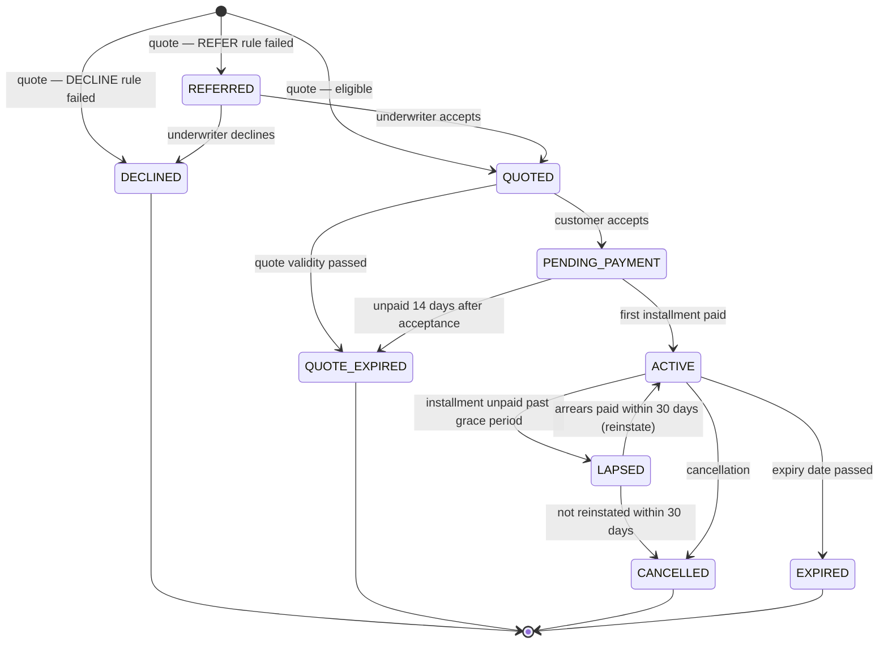
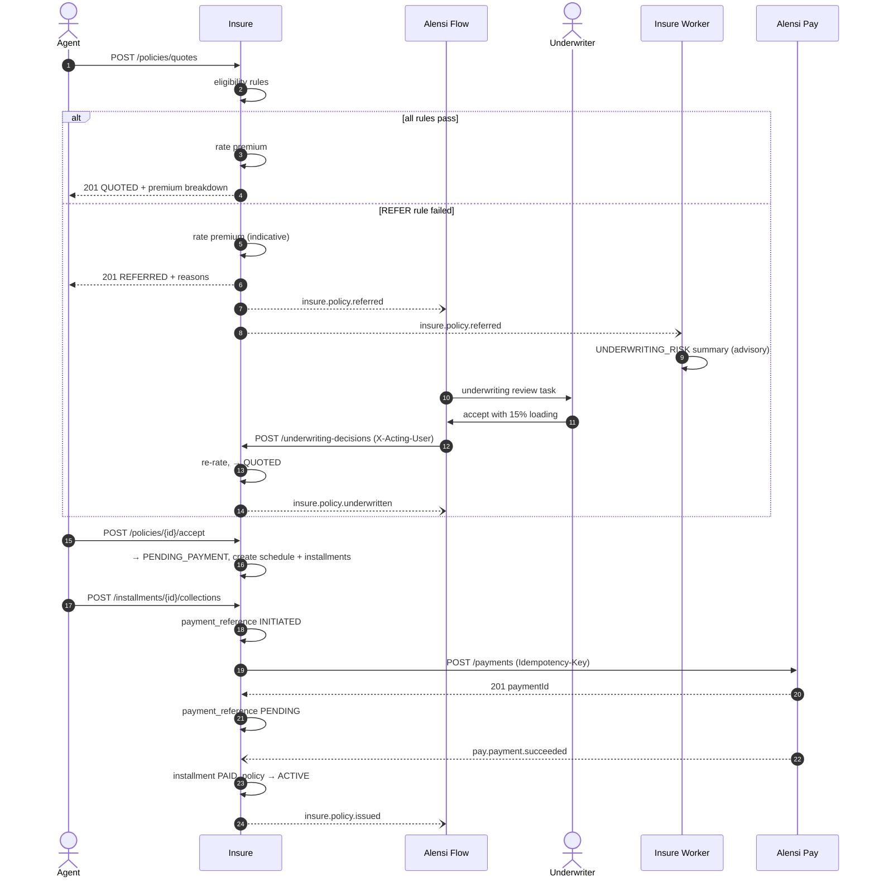
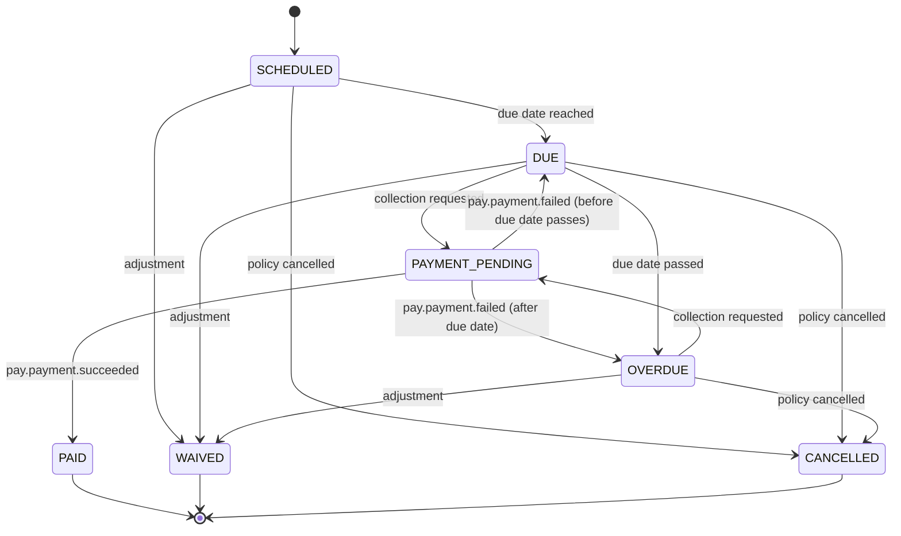
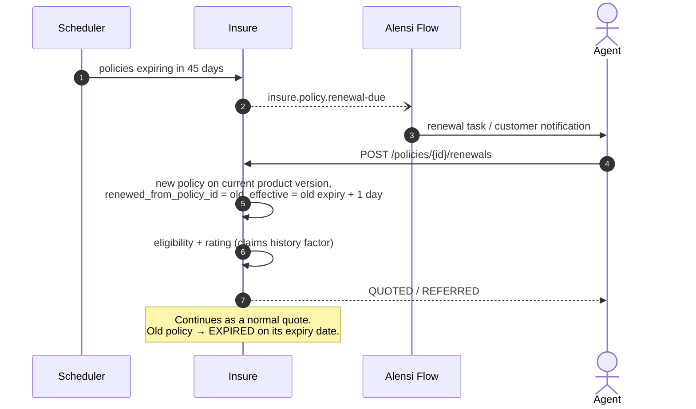

# Policy Lifecycle

From quote to expiry: states, who triggers each transition, and how Insure works with Alensi Flow and Alensi Pay along the way.

Insure owns the **policy state machine** — which transitions are legal and what invariants hold. Flow owns the **human process** around it (underwriting review, reminders, renewal outreach). Pay moves the money.

## States

## Transitions

| From → To | Trigger | Actor | Rules enforced by Insure | Event |
|---|---|---|---|---|
| — → `QUOTED` / `REFERRED` / `DECLINED` | `POST /policies/quotes` | Agent | Product version published and effective; customer active; insured items valid for item type; eligibility rules evaluated; premium rated | `insure.policy.quoted` / `insure.policy.referred` |
| `REFERRED` → `QUOTED` / `DECLINED` | `POST /policies/{id}/underwriting-decisions` | Underwriter via Flow | Acting user has `insure.underwriting.decide`; loading re-rates the premium | `insure.policy.underwritten` |
| `QUOTED` → `PENDING_PAYMENT` | `POST /policies/{id}/accept` | Agent | Quote not expired; creates premium schedule | — |
| `QUOTED` → `QUOTE_EXPIRED` | Scheduler | System | `quote_expires_at` passed (default 7 days) | — |
| `PENDING_PAYMENT` → `QUOTE_EXPIRED` | Scheduler | System | First installment unpaid 14 days after acceptance; schedule cancelled | — |
| `PENDING_PAYMENT` → `ACTIVE` | `pay.payment.succeeded` for installment 1 | Pay | Installment fully paid; `effective_date` may not be in the past — if it is, effective date moves to payment date and expiry is recalculated | `insure.policy.issued` |
| `ACTIVE` → `LAPSED` | Scheduler | System | Oldest unpaid installment `due_date + grace_period_days` passed | `insure.policy.lapsed` |
| `LAPSED` → `ACTIVE` | `pay.payment.succeeded` clearing arrears, then `POST /reinstate` | Agent | All overdue installments paid; within 30 days of lapse. **No cover for incidents during the lapse** | `insure.policy.reinstated` |
| `ACTIVE` → `CANCELLED` | `POST /policies/{id}/cancel` | Agent | Reason required; no open claims in `AWAITING_DECISION` or later unless reason is `MISREPRESENTATION`; pro-rata refund calculated | `insure.policy.cancelled` |
| `ACTIVE` → `EXPIRED` | Scheduler | System | Day after `expiry_date` | `insure.policy.expired` |

Every transition writes an audit event with the actor (and the acting user for Flow calls).

## Quote and Issue

### Eligibility and rating

Both are deterministic and fully explained in the quote response:

1. Build facts from customer, insured items, requested coverages, and effective date.
2. Evaluate every eligibility rule. Any `DECLINE` failure → `DECLINED`. Otherwise any `REFER` failure → `REFERRED`. Messages are returned.
3. For each coverage: `base_premium × Π matching rating factor multipliers`.
4. Sum coverages, apply underwriting loading if any, apply `minimum_premium`.
5. Split into installments by payment frequency; rounding difference goes on installment 1.

## Premium Collection

Insure tracks payment status; Pay executes payments ([ADR-0004](../decisions/0004-payments-via-alensi-pay.md)).

Failure handling:

- **Timeout calling Pay** → payment reference `UNKNOWN`. A reconciliation job re-sends the request with the **same idempotency key** (Pay returns the existing payment) or queries `GET /payments/{id}`. The installment stays `PAYMENT_PENDING`; no second payment is created.
- **Duplicate or out-of-order Pay events** → de-duplicated by message ID; events older than `last_event_at` are ignored.
- **Collection succeeded after the policy lapsed** → installment `PAID`; the agent reinstates. If beyond the reinstatement window, Flow starts a refund approval.

Reminders and dunning (`installment-due`, `installment-overdue`) are Flow processes; Insure only emits the events.

## Coverage in Force

Claims ask "was this policy in force on the incident date?" The answer is deterministic:

- Status history shows the policy `ACTIVE` on that date (from the audit trail of transitions, materialised as status periods), **and**
- The date is between `effective_date` and `expiry_date` (or `cancelled_at`), **and**
- The date is not inside a lapse period, even if the policy was later reinstated.

## Renewal

A renewal is a **new policy** linked to the previous one, not a mutation. This keeps every policy's terms immutable for the claims made under it. If the product version the old policy used has been withdrawn, the renewal uses the current published version; differences are listed in the quote.

## Cancellation

1. Agent submits `reason` and `effectiveDate` (not before today unless reason is `MISREPRESENTATION`, which voids from inception).
2. Insure checks open claims (see transition table).
3. Unpaid future installments → `CANCELLED`.
4. Pro-rata refund: `paid premium − earned premium`, where earned premium is `total_premium × days in force / term days`. Products may define a short-period scale instead.
5. Refund recorded as a `CANCELLATION_REFUND` adjustment. Flow runs refund approval; on approval Flow calls Insure to request a refund payment through Pay.
6. `insure.policy.cancelled` published.
